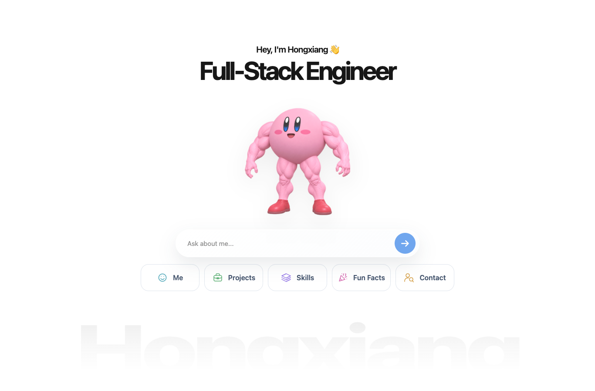
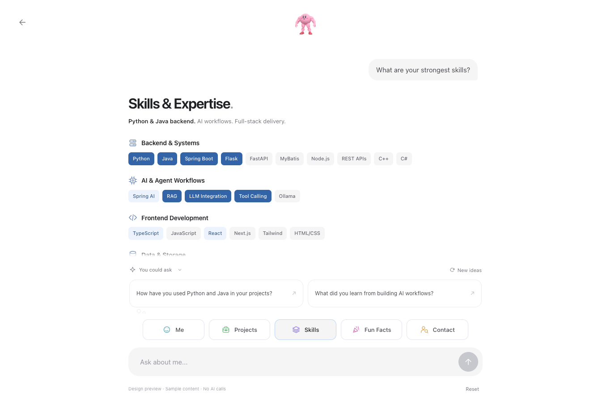
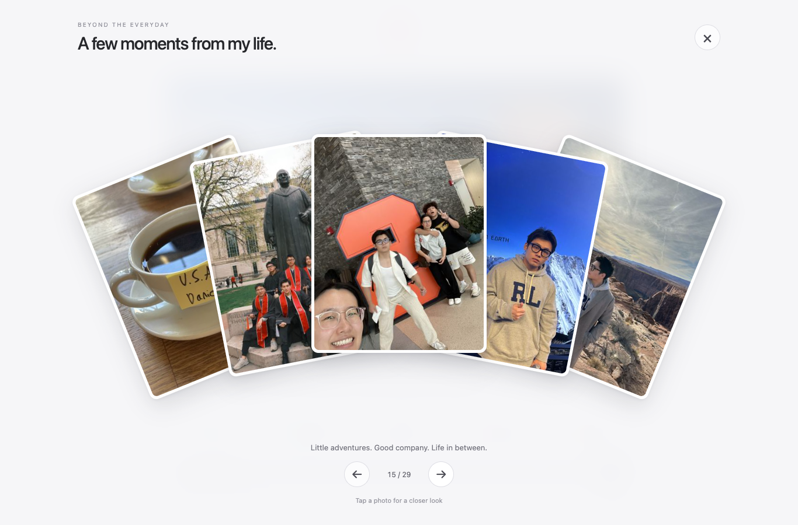
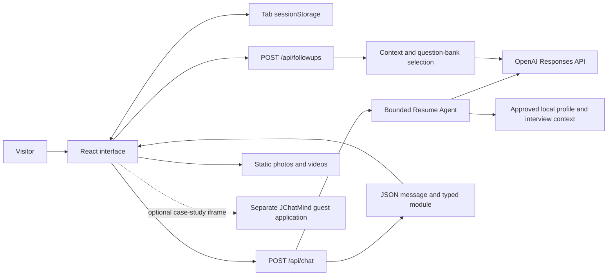

# Hongxiang Wang · AI Portfolio

**An interactive portfolio that lets visitors explore an engineer's work through conversation.**

[Live website](https://hongxiangwang1017.com) · [Ask the portfolio](https://hongxiangwang1017.com/chat) · [中文学习手册](docs/handbook/README.md) · [v0.9 release notes](docs/releases/v0.9.0.md)



**v0.9.0 — Demo Preview** is the milestone before the formal demo release. It packages the current experience, the ordered photo collection and a source-based architecture handbook. The latest verified production deployment is recorded separately in [the deployment log](docs/deployment-2026-10-29.md); publishing a GitHub release does not update that server.

## What you can explore

Choose **Me**, **Projects**, **Skills**, **Fun Facts** or **Contact**, or ask a question in English or Chinese. The AI writes a short answer from approved context; the application renders the corresponding interface.

| Experience | What it does |
| --- | --- |
| Me | Personal overview with portrait, education, experience and sourced rankings. |
| Projects | Browse selected work, then open the JChatMind or Lyntra case study. Follow-up questions track the selected project. |
| Skills | Capability groups led by Python/Java backend and AI integration; visual emphasis is positioning, not a proficiency score. |
| Fun Facts | A single skydiving cover opens an ordered 29-photo fan; enlarge an image or explore three training videos. Media browsing makes no chat-model call. |
| Contact | Copy the five approved contact methods, with accessible success feedback and a manual fallback. |
| Conversation | Typed questions, retry after failures, cached presets, tab-local history and drafts, and optional contextual follow-ups. |



*The chat screenshots use the development preview's labelled sample copy. They show the real UI components, not generated mockups or evidence of model quality.*

<details>
<summary>See the ordered photo collection</summary>



</details>

## Why this project is interesting

- **A bounded AI workflow.** Every uncached chat answer uses a read-only `get_resume_profile` tool before the final response. Visitor messages cannot edit the source profile.
- **Typed presentation.** The model selects one of six presentation values; React owns the actual cards and exact contact/profile data. Model prose is not executed as HTML.
- **Context with useful limits.** Forty curated interview entries support project-aware follow-ups through local lexical selection and optional question references. This Portfolio does not use a live vector database or runtime Notion access.
- **Interaction beyond the chat box.** A WebGL fluid cursor, a glass-star follow-up control, a reference-frame liquid animation, ordered photo transitions and on-demand videos make the portfolio personal.
- **Recoverable browser behavior.** Successful presets reuse their answer; failures restore the question; completed turns and unsent text survive refresh in the same tab. Suggestions have their own cancellation and stale-response handling.
- **Explicit system boundaries.** The recorded JChatMind replay is local evidence. Its optional live iframe connects to a separate Spring Boot / pgvector / Ollama application; that stack is not this repository's chat backend.

## Architecture at a glance



The server sends one complete JSON answer. Text arrival animation is a frontend effect; this Portfolio does **not** stream model tokens. On a normal uncached turn, `/api/chat` makes two Responses calls; generating a suggestion pair makes one additional call. Cached answers avoid the two chat calls, while refreshing suggestions still has a model cost.

## Stack

| Layer | Current implementation |
| --- | --- |
| UI | React 19, TypeScript, CSS, native dialogs and media controls |
| Routing and build | Vinext, Vite; App Router-style `app/` structure |
| AI | OpenAI Responses API via server-side `fetch`, function calling and strict structured output |
| Data | Versioned TypeScript profile objects and a server-side JSON interview snapshot |
| Browser state | React state/refs and `sessionStorage`; no account sync |
| Validation | Node test runner with mocked upstream, Playwright, TypeScript and ESLint |
| Production | Node build in Docker, Compose, Nginx and HTTPS on Tencent Lighthouse |
| Additional target | Cloudflare Worker entry and retained Sites configuration; separate from the current VPS deployment |

Exact dependency versions live in [package.json](package.json) and [package-lock.json](package-lock.json). The configured model is currently `gpt-5.6-luna` in [resume-agent.ts](lib/agent/resume-agent.ts); provider access is required for real answers and is separate from the mock test suite.

## Run locally

Use **Node.js 22.13+** and the locked dependencies:

```bash
npm ci
```

For real AI requests, create an ignored `.dev.vars` file in the checkout:

```dotenv
OPENAI_API_KEY=replace_with_your_own_runtime_key
```

```bash
npm run dev
```

Open the URL printed by the dev server, normally [localhost:3000](http://localhost:3000). Restart after changing Worker bindings. `.dev.vars` takes precedence over `.env*` for the local Cloudflare Worker; production secrets are configured separately. Do not commit keys.

For UI work without a model key, open `/preview/chat`, `/preview/fun-facts` or `/preview/followups`. These routes label their sample data, make no model requests and return 404 in production.

For the Node deployment build:

```bash
PORTFOLIO_DEPLOY_TARGET=node npm run build
npm run start -- --hostname 127.0.0.1 --port 3000
```

Configure the runtime key in the process/container environment when running this target. See [development and operations](docs/handbook/04-development-and-operations.md) for target differences and deployment verification.

## Verify changes

```bash
npx playwright install chromium
npm test
node node_modules/typescript/bin/tsc --noEmit --incremental false
npm run lint
```

If Chrome is already installed, use `PLAYWRIGHT_CHANNEL=chrome npm test` instead. `npm test` builds the app, runs mocked API checks and starts a production server on `127.0.0.1:3103` for the browser suite. It does not need a live API key. Failures retain Playwright traces under `test-results/`.

Fresh release evidence belongs in [v0.9 notes](docs/releases/v0.9.0.md). Mock tests prove the tested contracts and browser behavior; the [October 29 production record](docs/deployment-2026-10-29.md) separately records real API and desktop/mobile acceptance for source `018a0d3`.

## Learn the implementation

The [Chinese handbook](docs/handbook/README.md) follows the path from a visitor action to a rendered answer, then explains how to change and operate the project.

| Chapter | Questions it answers |
| --- | --- |
| [1 · System architecture](docs/handbook/01-architecture.md) | What runs where? Which repository owns each capability? |
| [2 · Agent and data](docs/handbook/02-agent-and-data.md) | How do tool calls, API contracts, approved facts and interview references work? |
| [3 · UI and state](docs/handbook/03-ui-and-state.md) | How do cache, drafts, retries, suggestions, scrolling and media lifecycles interact? |
| [4 · Development and operations](docs/handbook/04-development-and-operations.md) | How do I run, test, debug, release, deploy and recover it? |
| [5 · Learning and improvement](docs/handbook/05-learning-and-roadmap.md) | What should I read first, what can I experiment with, and what remains unfinished? |

For maintainers, [CONTEXT.md](CONTEXT.md) defines project vocabulary; [CHANGELOG.md](CHANGELOG.md) records changes. The [question-bank review](docs/question-bank-review.md) records the source snapshot and factual boundaries.

## Before the formal demo

This is a functioning preview, with limits worth understanding before expanding it:

- No Portfolio accounts, database-backed conversation history or cross-device sync.
- The 15-turn limit is a request/client conversation limit, not a durable per-user usage quota. This repository does not implement server-side visitor authentication or distributed rate limiting.
- Browser cancellation does not currently propagate into the Agent's upstream `fetch` controller. Prompt length guidance is not an independently enforced semantic guarantee.
- No Portfolio vector retrieval, arbitrary tool execution, background agent jobs or model-token streaming.
- Footprints and some project case-study destinations remain explicitly marked as upcoming.
- The Node model-evaluation scripts make real paid requests and include historical expectations; they require review against the version being evaluated. They are not part of `npm test`.

The [prioritized roadmap](docs/handbook/05-learning-and-roadmap.md) separates these gaps from implemented features and gives a verification path for each proposed change.

## Assets and credits

The UI contains owner-supplied personal content and media; see [asset sources](public/ASSET_SOURCES.md), [photo processing](public/life/collection/README.md), [video notes](public/gym/videos/README.md) and [AI animation notes](public/ai/README.md). Profile facts and personal photos serve different roles: gallery captions do not become Agent biography.

The fluid simulation is adapted from React Bits Splash Cursor. Attribution and third-party license notices are retained in [THIRD_PARTY_NOTICES.md](THIRD_PARTY_NOTICES.md). This release does not add a blanket license grant for personal photographs or introduce a new repository license.
