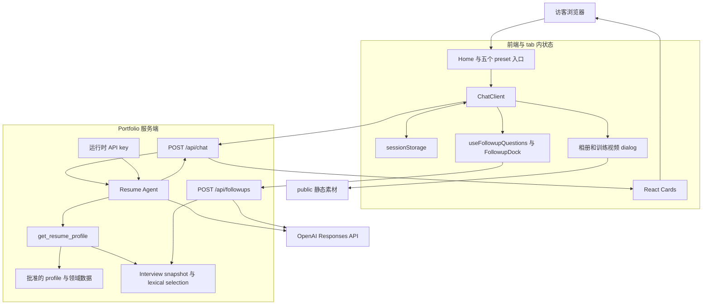
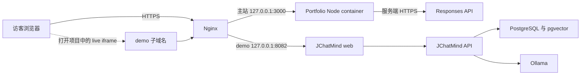
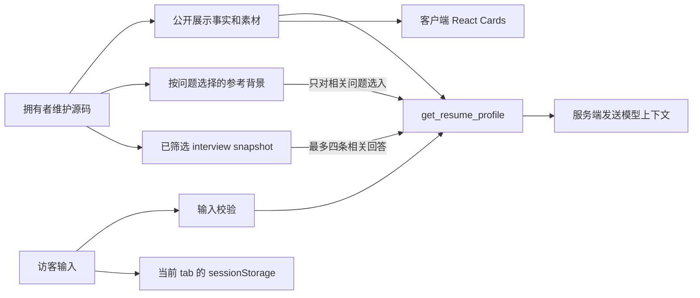

# 1 · 整体架构与模块地图

[手册目录](README.md) · 下一章：[Agent 与数据](02-agent-and-data.md)

## 1.1 项目解决什么问题

Portfolio 是一个以对话为入口的个人展示站点。访客可以看页面，也可以用自然语言追问；服务端结合已批准事实生成简短回答，前端再呈现代码定义的 Profile、Projects、Skills、Fun Facts 或 Contact 卡片。

它同时包含三个容易混淆的展示层：

| 对象 | 属于哪个系统 | 是否调用真实模型 |
| --- | --- | --- |
| Portfolio `/chat` | 本仓库的 React UI 与两个 API routes | 新主回答、生成追问时调用 Responses API |
| JChatMind / Lyntra case study | 本仓库的项目说明、素材与本地交互 | 浏览说明和录制回放不调用模型 |
| JChatMind live guest iframe | 独立部署的原始 JChatMind 应用 | 由那个应用处理自己的真实模型请求 |

不能因为 Portfolio 展示了 Spring Boot、pgvector 或 Ollama，就把它们画成本仓库 `/api/chat` 的依赖。

## 1.2 逻辑架构

`app/` 风格的目录不意味着项目使用 Next.js server 运行：实际 npm scripts 调用 Vinext，build tool 是 Vite。代码保留 `next/image` 等兼容接口，适配由 Vinext 处理。依赖精确版本见 [package.json](../../package.json)。

## 1.3 模块职责

| 位置 | 负责什么 | 不负责什么 |
| --- | --- | --- |
| [app/page.tsx](../../app/page.tsx) | 首页、GET form、preset 导航、SplashCursor | 运行 Agent loop |
| [app/chat/page.tsx](../../app/chat/page.tsx) | 读取入口 query 并交给 ChatClient | 生成回答 |
| [ChatClient](../../app/chat/ChatClient.tsx) | 会话、请求、preset cache、渲染选择、滚动和草稿 | 保存数据库会话 |
| [useFollowupQuestions](../../app/chat/useFollowupQuestions.ts) | 追问状态、延迟、取消与过期结果过滤 | 生成主回答 |
| [app/api/chat](../../app/api/chat/route.ts) | 校验输入、检查 runtime key、调用 Agent、映射 module/error | 接受浏览器提供的事实替换 |
| [app/api/followups](../../app/api/followups/route.ts) | 追问契约、配置检查、错误映射 | 对外暴露完整题库 |
| [resume-agent.ts](../../lib/agent/resume-agent.ts) | 固定 tool workflow、模型调用、输出解析 | 任意工具执行、后台任务 |
| [interview-bank.ts](../../lib/agent/interview-bank.ts) | 项目范围、关键词评分、候选筛选与排除 | embeddings 或向量检索 |
| [lib/portfolio](../../lib/portfolio) | profile、contact、skills、projects、fitness、session 契约 | 模型供应商的网络通信 |
| [public](../../public) | 图片、视频、模型无关的展示素材 | 数据库或私有 secret store |
| [tests](../../tests) | public API、rendered HTML、浏览器可见行为回归 | 证明真实模型永久可靠 |

其中卡片各自集中 UI 逻辑，API route 集中边界转换，Agent 模块集中供应商协议，profile 模块集中事实；修改其中一个领域时，先看它的公共输入/输出，再进入内部实现。

## 1.4 当前生产拓扑

下图以 2026-10-29 的验收记录为准，不能代替下一次服务器检查。

- 主站生产入口是 Docker 中的 Node/Vinext，Compose 管理该 web service，Nginx 提供公网 HTTPS。
- JChatMind 有独立的 web/API/PostgreSQL/Ollama 容器；只因同一主机和 case-study 入口关联，不共享 Portfolio 的会话状态。
- Portfolio runtime 通过 `JCHATMIND_DEMO_URL` 决定是否展示可连接的 iframe。URL 来自服务端配置，不是访客任意输入的代理地址。
- 实际 image、source revision、loopback 端口、回滚文件及验证结果见[部署记录](../deployment-2026-10-29.md)。不要从文档中的旧容量推断当前容量。

### 另一个保留的运行目标

[worker/index.ts](../../worker/index.ts) 导出 Vinext App Router handler；[vite.config.ts](../../vite.config.ts) 配置 Cloudflare plugin、Vinext 和 Sites 集成。[hosting manifest](../../.openai/hosting.json) 保留 Site identity，D1/R2 bindings 为空。

这说明仓库保留 Worker/Sites 构建路径，不表示 v0.9 已重新部署到 Sites，也不表示 Portfolio 使用 D1/R2 数据库。`PORTFOLIO_DEPLOY_TARGET=node` 只在构建时跳过 Sites plugin；它不自动创建 Docker/Nginx 配置或把 secret 传到服务器。

## 1.5 数据在哪里

| 数据 | 来源与生命周期 | 注意 |
| --- | --- | --- |
| Resume/profile | 随版本发布的 TypeScript 对象 | 由拥有者维护；访客输入不会写回它 |
| Contact/Skills/Projects/Fitness | 各自领域模块 | UI 与 Agent 可复用同一事实，视觉强调不等于熟练度评级 |
| Interview bank | 40 条整理后的 server-side JSON snapshot | 更新需要源码发布，没有 runtime Notion 同步 |
| 参考背景 | 代码中按问题选择的字段 | 不进入无关 overview、Fun Facts 或主动追问；文档不重复其个人值 |
| 会话和草稿 | 浏览器 sessionStorage | 当前 tab 范围；没有服务器历史库和跨设备同步 |
| API key | runtime env / 本地 ignored binding 文件 | 不进入 Git、卡片或浏览器请求 payload |
| 29 张相册照片 | 原 cover + 28 张提供的照片，展示图与缩略图 | 相册 alt/caption 不是 Agent 的新个人事实 |

“只在服务端使用”与“秘密数据”不是同义词：如果一个值出现在公开仓库源码中，服务端作用域不会赋予它访问控制。真正的凭据必须放在 runtime secret 中。

## 1.6 六种输出为什么分开

模型的 `presentation` 是语义选择，route 再转换为浏览器契约：

| Agent presentation | API module.type | 前端组件 |
| --- | --- | --- |
| `text` | 不带 module | AnimatedText / 文字消息 |
| `profile_card` | `profile`，附代码构造的 profile | ProfileCard |
| `contact_card` | `contact`，附批准的 contact | ContactCard |
| `projects_card` | `projects` | ProjectsCard |
| `skills_card` | `skills` | SkillsCard |
| `fun_facts_card` | `fun_facts` | FunFactCard |

模型可以生成简介，但不负责拼接 contact URL、把任意模型 HTML 注入页面，或给卡片编造额外字段。这个分工使“表达可以灵活、展示事实尽量确定”成为可检查的行为；它不能保证所有自然语言都绝无错误。

## 1.7 从实现能看到的取舍

| 当前选择 | 获得的好处 | 代价 / 何时重看 |
| --- | --- | --- |
| 事实和题库跟代码发布 | 来源明确、可 review、可回滚 | 修改资料要发布；多人编辑或大量内容时可能需要 CMS |
| 固定两阶段 tool workflow | 调用上界清楚，事实注入集中 | 每个 uncached answer 有两次供应商请求 |
| 卡片由 React 拥有 | 结构稳定、可访问性和测试更可控 | 新卡片要同时改 enum、route、UI、session 和测试 |
| tab-local storage | 不需账号/数据库，刷新可继续 | 无跨设备；浏览器存储失败时只能降级 |
| 完整 JSON 后再动画 | retry/结构解析简单 | 用户必须等完整结果；没有 token streaming |
| 可选追问独立接口 | 失败不阻塞主回答 | 多一次模型调用，也多一套取消/去重状态 |
| Node 与 Worker 路径并存 | 保留不同运行方式 | 必须区分 build、binding 与生产配置，不能假定测试覆盖所有平台 |

以上是对现有实现的解释，不是补造历史 ADR。还没有做出的结构选择放在[改进路线](05-learning-and-roadmap.md)，不要提前写成架构事实。

## 1.8 用一条变更验证理解

假设要加入新的“语言能力卡”：

1. 确定批准事实应放在哪个领域模块；不要把数据写进 JSX 和 prompt 两份。
2. 确定是否真的需要新 presentation，还是现有 text/Skills 已能解决。
3. 若需要新类型，同时检查 Agent schema/parser、route mapping、ConversationMessage、渲染和 session 恢复。
4. 通过 API 验证 type/数据边界，通过浏览器验证真实可见行为。
5. 补章节和词汇，再独立做发布/部署验收。

完成后应能指出每一个新字段的所有者、经过的边界和失败后的状态，而不是只看到一张漂亮卡片。
