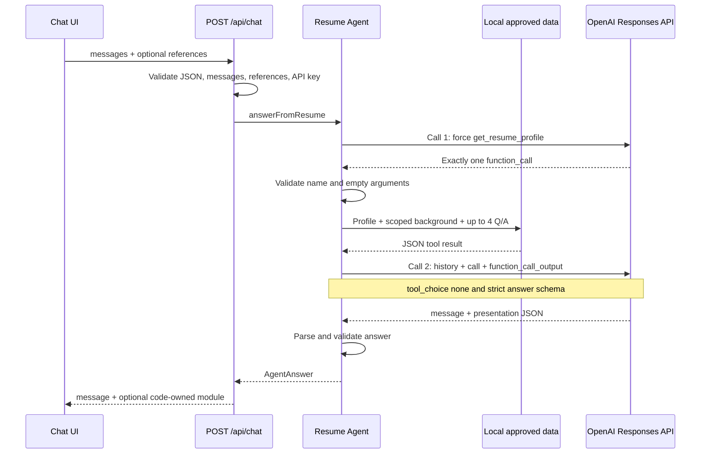
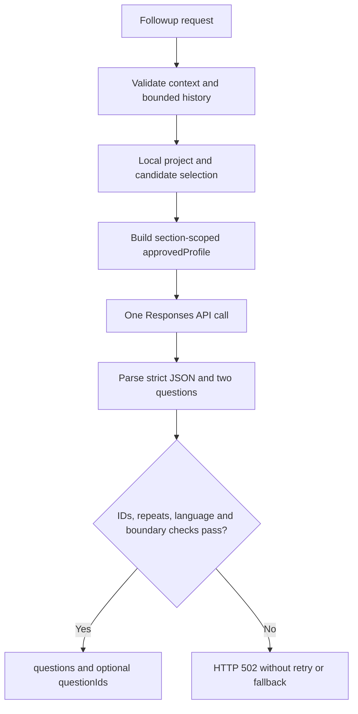

# 2 · Agent、API 与数据契约

[手册目录](README.md) · 上一章：[整体架构](01-architecture.md) · 下一章：[UI 与状态](03-ui-and-state.md)

本章解释 Portfolio 如何把访客问题变成有事实依据的回答，以及 Suggested questions 如何生成。以当前源码为准；JSON 中的回答文案是契约示例，不代表真实模型验收结果。

## 1. 先建立正确的系统边界

Portfolio 的核心路径是 `Chat UI → API route → Resume Agent → 本地 approved profile / Interview Question Bank → OpenAI → JSON → React`。

- **Portfolio Agent**：一个服务端受控工作流，使用 OpenAI Responses API；没有多 Agent 协作、独立任务调度器或通用工具执行器。
- **本地数据**：TypeScript profile、Case Study 和随版本发布的 JSON 问答快照；运行时不读原始 PDF、不抓取 Notion、不检索外部网页。
- **检索方式**：题库的中英关键词匹配、项目范围过滤和排序；没有 embedding、Vector Database 或 runtime vector RAG。
- **JChatMind**：Portfolio 展示的另一个项目，其 Java / Spring AI / pgvector 架构是 Case Study 内容，不是本网站 Agent 的运行依赖。
- **模型职责**：生成自然语言、选择 `presentation`、提出两个后续问题；卡片事实和 UI 结构由代码提供。

先读 [API route](../../app/api/chat/route.ts)、[Resume Agent](../../lib/agent/resume-agent.ts)、[resume-profile](../../lib/portfolio/resume-profile.ts)，再读 [interview-bank](../../lib/agent/interview-bank.ts)。术语定义见 [CONTEXT.md](../../CONTEXT.md)。

## 2. 文件与职责

| 文件 | 负责什么 | 不负责什么 |
| --- | --- | --- |
| [app/api/chat/route.ts](../../app/api/chat/route.ts) | 解析请求、读取 API key、调用 Agent、把 presentation 转为 module、映射 HTTP 错误 | UI 布局、题库匹配算法 |
| [app/api/followups/route.ts](../../app/api/followups/route.ts) | 校验追问请求、调用生成器、返回 questions | 消耗对话轮次、静态追问 fallback |
| [lib/agent/resume-agent.ts](../../lib/agent/resume-agent.ts) | OpenAI fetch、tool contract、两阶段回答、追问生成、输出校验 | 存储会话、加载远程个人资料 |
| [lib/agent/interview-bank.ts](../../lib/agent/interview-bank.ts) | server import 的快照、关键词评分、项目与角度过滤 | 向量相似度、模型 classifier |
| [lib/portfolio/interview-context.ts](../../lib/portfolio/interview-context.ts) | client-safe 项目 ID、题目 ID、项目识别、近似重复判断 | 题库答案内容 |
| [lib/portfolio/followup-questions.ts](../../lib/portfolio/followup-questions.ts) | request / response 类型和纯校验函数 | 网络请求与 UI 状态 |
| [lib/portfolio/resume-profile.ts](../../lib/portfolio/resume-profile.ts) | 汇总 approved facts、构建 Profile Card 数据 | 现场解析简历 PDF |
| [lib/portfolio/personal-profile.ts](../../lib/portfolio/personal-profile.ts) | public 个人事实、按直接问题选择 request-only background | 给主动追问提供完整背景 |

## 3. `/api/chat`：访客提交什么

一个追问点击可以携带项目和题目引用，普通输入只需要 `messages`：

```json
{
  "messages": [
    { "role": "user", "content": "Lyntra 如何处理日历冲突？" }
  ],
  "projectId": "lyntra",
  "questionId": "qb-02"
}
```

后续轮次仍发送历史文本，顺序为 `user → assistant → user`。客户端不提交 `system` / `developer` message，也不提交卡片 HTML、tool output 或 API key。

[parseChatMessages / parseChatReference](../../lib/agent/resume-agent.ts) 的实际规则：

| 字段 | 服务端规则 |
| --- | --- |
| `messages` | 必须为非空数组，最多 29 条，即最多 15 个 user turns |
| `role` | 只允许 user / assistant，从 user 开始交替，最后必须是 user |
| `content` | string，trim 后 1–1000；代码使用 JavaScript `String.length` |
| `projectId` | 可省略；只允许 portfolio / jchatmind / lyntra / brainstem / pcitc / edge |
| `questionId` | 可省略；必须是 qb-01–qb-40 且在当前快照中存在 |
| 项目与题目关系 | 最后一条问题明确点名的项目优先于 projectId；若与题目所属项目冲突，返回 400 |

chat parser 会提取合法的 role / content；与 followups 不同，它没有拒绝所有额外 payload / message 字段的检查。不要把这种容忍当成可扩展的公开字段契约。

15 turns 是对本次 payload 的限制。route 没有保存用户累计使用次数，也没有建立跨请求、跨浏览器的服务端 quota。

### 返回值：AgentAnswer 与 API response 是两层契约

模型先输出内部对象：

```json
{
  "message": "后端会检查目标时间的占用情况，并在保存前保持任务时长。",
  "presentation": "text"
}
```

route 对外返回：

```json
{
  "message": "后端会检查目标时间的占用情况，并在保存前保持任务时长。"
}
```

模型选择卡片时，route 把 `presentation` 转成 `module`，不会把内部 presentation 字段原样暴露：

| 模型 presentation | API module | 数据来源 |
| --- | --- | --- |
| `text` | 无 module | 模型生成的 message |
| `profile_card` | `{ type: "profile", profile: ... }` | `getResumeOverviewCard(message)`；summary 来自模型，其余为代码数据 |
| `contact_card` | `{ type: "contact", contact: ... }` | 固定 contactProfile |
| `projects_card` | `{ type: "projects" }` | 前端读取共享 Projects 数据 |
| `skills_card` | `{ type: "skills" }` | 前端读取共享 Skills 数据 |
| `fun_facts_card` | `{ type: "fun_facts" }` | 前端组合 approved 内容、图片与入口 |

例如，Projects overview 的响应形状为：

```json
{
  "message": "可以从 Portfolio、JChatMind 和 Lyntra 看我的工程实践。",
  "module": { "type": "projects" }
}
```

广义介绍用 Profile Card、具体技术追问用 text 等规则主要写在模型 instructions 中；后置校验检查 enum，没有额外的确定性 intent router 来强制修正卡片选择。

## 4. 固定两阶段 tool loop



[answerFromResume](../../lib/agent/resume-agent.ts) 不是无限 `while` loop：

1. 第一轮传入 instructions 和全部合法 messages，只注册一个 `get_resume_profile` function tool，强制选择该工具，关闭 parallel tool calls。
2. 返回中必须恰好有一个满足 function_call 结构的调用；工具名必须正确，arguments 必须解析成无字段的 `{}`。
3. 服务端本地执行工具：读取 `getResumeProfile()`，根据最后的问题补充相关 background，再选最多四个题库答案。
4. 第二轮输入为原 messages、第一轮完整 output、带对应 call_id 的 function_call_output；不使用 `previous_response_id`。
5. 第二轮 `tool_choice: "none"`，要求 strict JSON schema，只能返回 message 和合法 presentation。
6. 应用解析结果，trim message；无文本、非 JSON、空 message、未知 presentation 都按 upstream failure 处理。

成功生成回答固定需要 **2 次 OpenAI HTTP 调用、1 次本地 tool 执行**；第一阶段失败时不会继续第二阶段。即使是问候或一般问题，当前工作流也会先调用 resume tool。

### 上游参数和时间边界

| 配置 | 当前值 / 含义 |
| --- | --- |
| endpoint | `https://api.openai.com/v1/responses`，原生 fetch，无 OpenAI SDK |
| model | 源码常量 `gpt-5.6-luna`，当前没有 model 环境变量覆盖入口 |
| reasoning / verbosity | `effort: "none"` / `verbosity: "low"` |
| max_output_tokens | 每次调用 300；这是 token 预算，不等于 300 characters |
| store | 每次调用显式 `false`；仍会把请求所需历史和 grounding 发给 OpenAI |
| upstream timeout | 每次 15,000ms；计时覆盖 fetch 和 response.json body read |
| chat 总等待 | 两次顺序调用的超时预算合计约 30s，另有本地处理开销；不是独立的 30s 总 deadline |
| browser timeout | ChatClient 为回答请求设置 35,000ms，见 [ChatClient](../../app/chat/ChatClient.tsx) |

这里的 `store:false` 表达本请求不要求 Responses API 存储响应，不能由此推导服务商所有日志和保留政策。浏览器取消也没有通过 request.signal 接到本地两个上游 controller，不能据此保证服务端生成同时停止。

没有自动 retry、额外 classifier、工具并发或第三轮修复 JSON。最终响应是一次完整 JSON，前端的 Answer reveal 动画不代表 token streaming。

## 5. `/api/followups`：独立的一次生成

Suggested questions 不走 chat 的 forced-tool 两轮路径，也不增加 messages 里的 user turns。请求示例：

```json
{
  "context": "Projects",
  "messages": [],
  "exclude": [],
  "projectId": "lyntra",
  "excludeQuestionIds": []
}
```

`messages: []` 合法，默认生成 English；若最后一个 user message 含 CJK 字符范围 `\u3400–\u9fff`，本次要求 Simplified Chinese，否则要求 English。这是简单字符检测，不是多语种语言识别器。

响应示例，题目措辞由模型生成：

```json
{
  "questions": [
    "What did you personally contribute to Lyntra's backend?",
    "How does the prototype handle a calendar scheduling conflict?"
  ],
  "questionIds": ["qb-01", null]
}
```

有题库 candidates 时，第一条由候选题启发并携带其真实 ID，第二条从不同角度延伸且 ID 必须为 null；没有 candidates 时仍由模型生成两个问题，响应只保留 questions。

### Request 校验

| 字段 | 规则 |
| --- | --- |
| `context` | Me / Projects / Skills / Fun Facts；Contact 不支持 |
| `messages` | 必填数组，0–6 条，从 user 开始交替；可结束于 user 或 assistant |
| message 内容 | 只允许 role / content 字段，trim 后 1–1000 characters |
| `exclude` | 必填数组，0–12 个旧追问，每个 trim 后 1–160 characters |
| `projectId` | 可选，同一组六个合法项目 ID |
| `excludeQuestionIds` | 可选，最多 40 个 qb-01–qb-40 格式的 ID |
| 额外字段 | 顶层及 message 的未知字段都会被拒绝 |

### Response 校验与失败方式

[parseFollowupResponse](../../lib/portfolio/followup-questions.ts) 要求恰好两个非空单行字符串，每条最多 160 characters、以 `?` / `？` 结尾；拒绝未知字段、重复、已问过和近似重复的问题。

随后 [generateFollowupQuestions](../../lib/agent/resume-agent.ts) 检查第一条 ID 在当前 candidates 中、第二条 ID 为 null；中文请求的两条问题都必须含中文字符。代码还对未共享的国籍、签证、work authorization、sponsorship 等招募信息执行词表过滤。

这些后置规则主要验证格式和有限边界，没有逐句事实证明器，也不完全验证任意跨语言复述。任一检查失败即返回 502；没有静态题库文案 fallback，也没有同请求自动重试。



## 6. Interview Question Bank 如何选材料

快照 revision 为 `2026-10-23-question-bank-1`，40 条，稳定 ID qb-01–qb-40；Lyntra 14 条、JChatMind 17 条、通用方法 9 条。条目含 `id / projectId / topic / question / answer / keywords / boundary` 等字段。

发布授权记录和审阅重点见 [question-bank-review.md](../question-bank-review.md)。`release-authorized` 表示快照有随版本发布的授权依据，不代表每条内容都已逐题审阅。

### 回答检索：最多四条

[selectInterviewAnswers](../../lib/agent/interview-bank.ts) 按以下顺序工作：

1. 用最后一个 user 问题明确点名的项目，其次 reference project，再其次较早 user 消息中最近明确提到的项目；若 reference 仅有 questionId，则其所属项目作为 hint。
2. project scope 保留该项目与 projectId 为 null 的通用条目；未识别项目时允许全部条目。
3. 用当前问题匹配 keywords：英文词边界匹配，中文等关键词 substring 匹配；完整短语通常加 4、英文单词加 3，多词片段全部出现但未完整匹配时加 2。
4. 只保留 score > 0，按 score 降序，再按稳定 ID 排序。
5. 合法 questionId 指定条目优先，其余按排名补足，最终最多四条。无匹配时不注入 interview 字段。

因此 questionId 是选证据的引用，不能替代访客的实际问题，也不是模型可以忽略 factual boundary 的许可。

### 追问候选：最多六条

[selectInterviewCandidates](../../lib/agent/interview-bank.ts) 先用显式 projectId hint，否则从对话推断项目；与回答侧不同，调用者传来的 hint 在这里优先。

- Fun Facts 不使用 Interview Question Bank；Me 只保留 contribution、initiative、goal、requirements、AI collaboration / verification / responsibility、debugging 等 behavioral topics。
- 根据最多两个最近 user 问题算 lexical score；所选项目内的条目额外加 10。
- excludeQuestionIds 阻止旧 ID，并连同已问问题最强 lexical match 阻止相同 `projectId:topic` 角度。
- 与 exclude 和已问问题近似重复的原题也被排除；剩余条目排序后最多六条送入模型。
- 无选中项目时允许项目型候选，即使 lexical score 为零；通用条目仍受上下文和 score 条件约束。

`nearDuplicateQuestion` 使用 NFKC / 大小写 / 标点空格归一化，以及英文词、中文双字符 token 的 overlap；至少各有三个 token 才做 0.75 Jaccard 阈值判断。它能降低明显重复，不等价于语义理解或完整的中文分词。

题库快照通过服务端 Agent import 路径使用；client-safe 模块只包含 ID 与匹配辅助函数。浏览器接收生成的问题和 ID，具体回答时服务器再读取公开答案草稿；不要把整份快照改成 client import。

## 7. Grounding 的来源与公开范围

| 数据 | 拥有它的代码 | 如何进入模型 / UI |
| --- | --- | --- |
| 教育、经历、技能及 profile 汇总 | [resume-profile](../../lib/portfolio/resume-profile.ts) / [skills-profile](../../lib/portfolio/skills-profile.ts) | 普通 resume tool 返回完整 approved profile；Profile Card 使用代码数据 |
| 项目状态、已演示与未完成功能 | [projects](../../lib/portfolio/projects.ts) | profile 汇总；Projects / Skills followups 按项目缩小范围 |
| 公开兴趣、宠物、游戏、合作记录 | [personal-profile](../../lib/portfolio/personal-profile.ts) 的 public | 普通 tool 的 personal；Fun Facts followups 的 public grounding |
| Contact / Fitness | [contact-profile](../../lib/portfolio/contact-profile.ts) / [fitness-profile](../../lib/portfolio/fitness-profile.ts) | approved tool 数据和代码卡片；followups 不提供 contact |
| request-only background | personal-profile 内非 public 常量 | 仅针对直接相关问题选择字段后加到 tool result 的 agentReference |
| 图片 caption 与 Photo collection manifest | [photo-collection](../../lib/portfolio/photo-collection.ts) | UI 展示材料，不自动成为新的 Agent 个人事实 |

`resumeProfile.source` 是 provenance 文件名，不触发每次请求解析 PDF。网页链接表示提供了该链接，不表示系统已读取其页面或验证其内容。

追问总有 name / headline，其他 approvedProfile 字段按 context 裁剪：Me 提供教育、经历、公开 interests / personality、skills summary；Projects 提供项目证据；Skills 另加 skillsFocus 和经历；Fun Facts 提供 public personal 与 fitness。它不包含 contact 或 request-only background；访客主动发进 history 的文本仍作为上下文传入，不能据此声称已做历史内容脱敏。

request-only background 通过最后一条问题的正则表达式选择，而非任意模型请求；本章不复制其个人值。它不属于广义 Profile Card、Fun Facts summary 或主动追问的资料来源。

### 描述事实时保留的边界

- 个人贡献、团队产出、已有代码与 AI coding support 分开；已有实现不自动证明本人独立完成。
- `demonstrated`、`inDevelopment`、`limitations` 保持各自语义；拟议的 retries、durable jobs、恢复策略必须保留 would。
- JChatMind 的历史 history-query 问题不自动归因于本人修复，也不代表当前版本仍有该问题。
- 自述、历史 peak、带日期的报告、gross sales 与可验证结果分开；不补造 metrics、收入、部署规模或精确个人时间线。

这些边界同时体现在 profile / snapshot 和 instructions 中；schema 校验本身不能证明最终自然语言全部符合边界。

## 8. HTTP 错误与可观测性

两个 route 的所有 JSON response 都设置 `Cache-Control: no-store`。错误格式统一为 `{ "error": "面向访客的英文说明" }`，不返回内部 stack 或上游原始 error body。

| HTTP | 触发条件 | chat / followups 的处理 |
| --- | --- | --- |
| 400 | 非 JSON、字段或引用不合法 | 返回 validation error，不调用 OpenAI |
| 503 | OPENAI_API_KEY 为空或仅空格 | 返回未配置说明，不调用 OpenAI |
| 502 | 上游 auth / rate limit / network / timeout、非法 tool / JSON / answer | chat 按 kind 给简短提示；followups 统一 temporarily unavailable |
| 500 | 非 AgentUpstreamError 的未预期异常 | 返回通用 unexpected error |

上游 401 / 403 被归类 authentication，429 为 rate_limit，其他非 2xx 为 upstream；网络 fetch 失败和 timeout 分别归类 network / timeout。对访客的 HTTP 状态都是 502，不直接透传上游 401 或 429。

route 对 AgentUpstreamError 记录 `kind / status / requestId / apiCode`；requestId 来自上游 x-request-id。当前这条日志不记录完整访客问题、tool result、API key 或上游原始错误说明；它也不是完整的分布式 tracing 或成本统计。

## 9. 已实现保障、当前限制与后续改动的分界

**已实现**：有限输入、引用校验、固定调用上限、上游 timeout、strict output schema、基本后置校验、代码拥有卡片事实、题库范围与重复抑制、通用错误响应。

**当前限制**：没有 route 层身份认证或持久会话计数；客户端可以重新构造合法 history；没有自动 retry、跨请求 idempotency、实时数据更新或事实校验器。题库选择是 lexical retrieval，model presentation 可能选错，prompt 的事实边界仍需内容评估。

**特别容易误读**：回答小于 900 characters、Fun Facts 恰好两句且最多 300 characters 目前是 instructions 约束；chat 的后置 parser 不检查这些长度和句数，也不拒绝所有额外 answer 字段。300 output tokens 可能让复杂输出不足，非法或空结果会失败，不会自动补完。

**若将来确实需要**：服务端 quota、端到端取消、输出长度硬校验、更多语言检测或 semantic retrieval 应分别设计、验证，再修改契约；本章不把这些方向写成已经交付的能力。

学习时可沿一条问题逐层追踪：`parseChatMessages → parseChatReference → answerFromResume → executeResumeTool → selectInterviewAnswers → extractAgentAnswer → route module mapping`。现有回归入口见 [followup-api.test](../../tests/followup-api.test.mjs)、[interview-bank-api.test](../../tests/interview-bank-api.test.mjs) 和 [rendered-html.test](../../tests/rendered-html.test.mjs)；本章只核对源码，不声称这些测试已在本次文档编写中运行。
