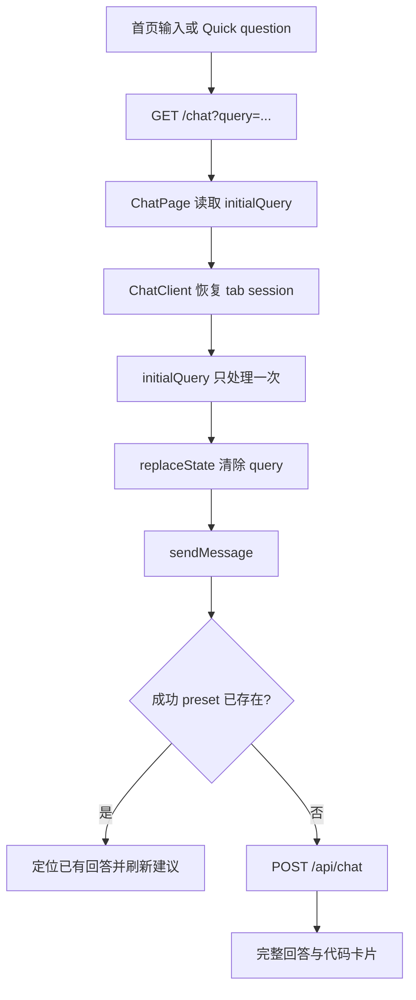
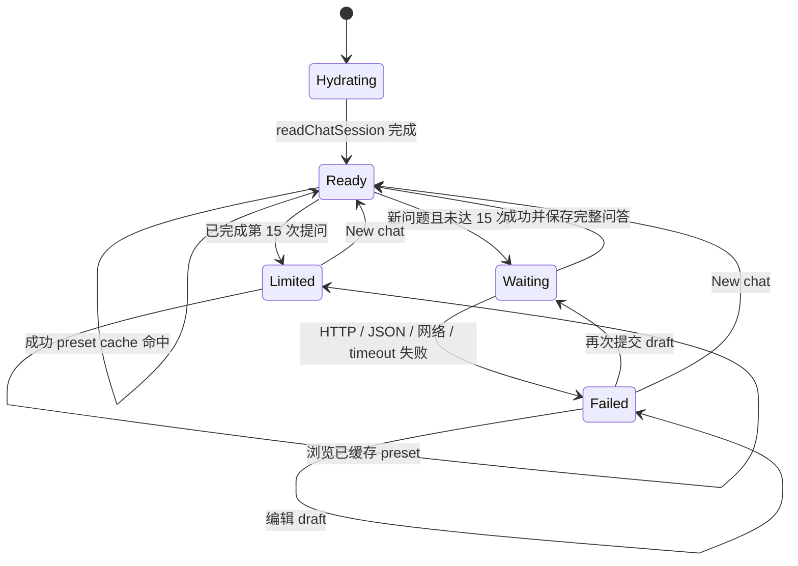
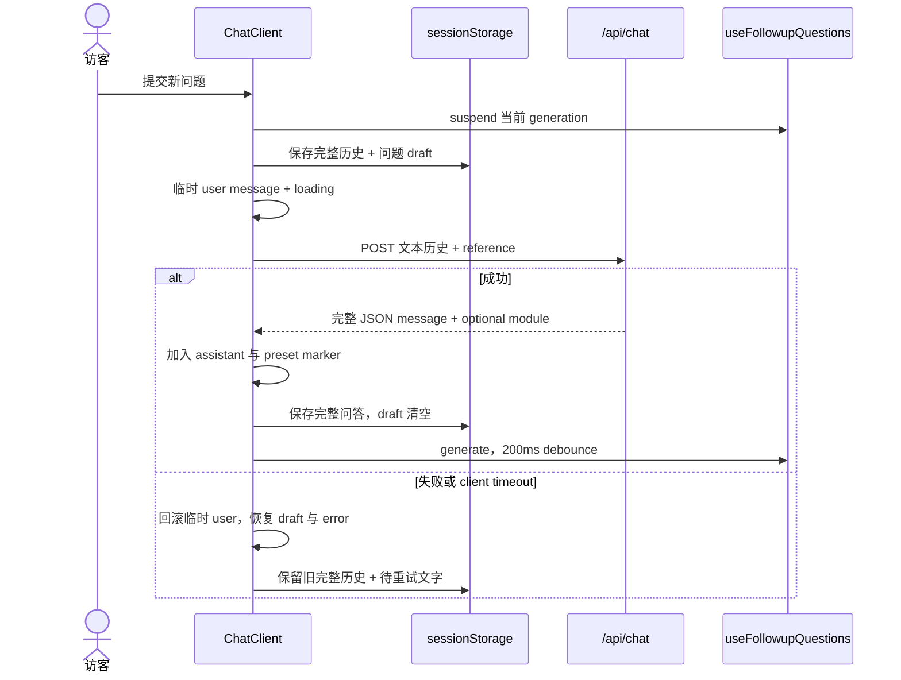
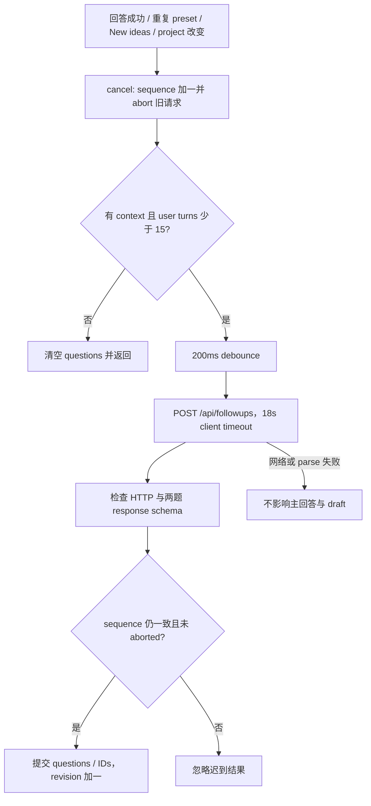
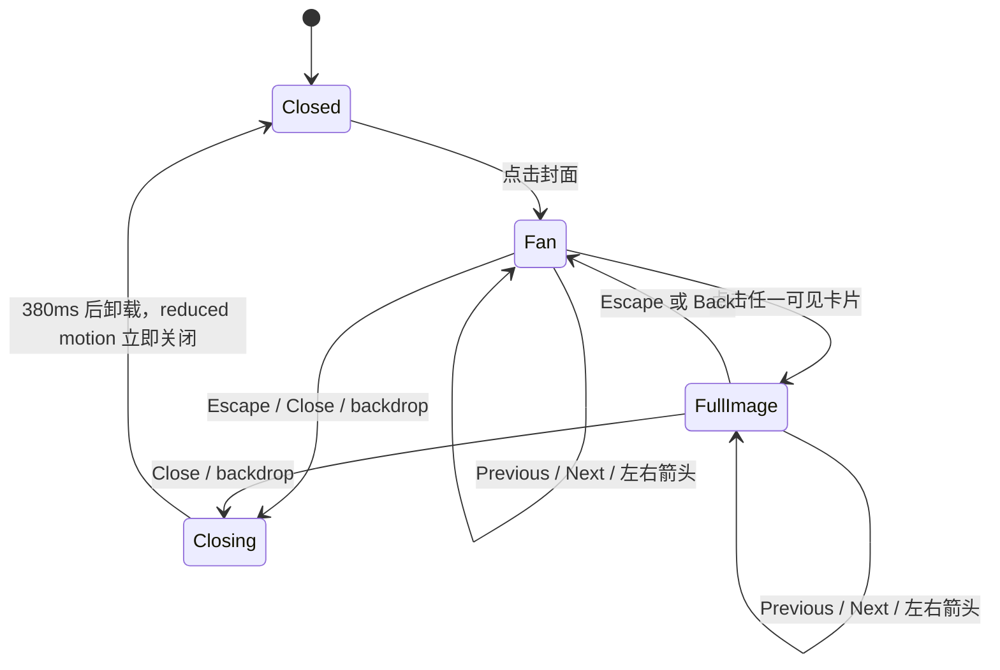

# 3 · UI、会话状态与媒体生命周期

[手册目录](README.md) · 上一章：[Agent 与数据](02-agent-and-data.md) · 下一章：[开发与运维](04-development-and-operations.md)

本章解释浏览器中一次提问、重复点击 preset、离开再返回、切换项目和打开媒体时发生什么。描述依据当前源码；流程图中的状态是对 React state / ref 的归纳，并非代码中另有一套 State Machine。

## 1. 页面与组件边界

| 页面 | 主要职责 | AI 请求边界 |
| --- | --- | --- |
| `/` | 首页形象、输入框、五个 Quick questions、鼠标流体效果 | 首页自身不调用 Agent；GET 导航到 `/chat?query=...` |
| `/chat` | 对话、代码卡片、preset cache、Suggested questions | 新问题调用 `/api/chat`；建议单独调用 `/api/followups` |
| `/gym` | 独立 Big Three Record 视频页 | 播放本地媒体，无 Agent 请求 |
| `/projects/lyntra` | 项目说明、录屏章节、工作流与架构图 | 浏览录屏和图示无 Agent 请求 |
| `/projects/jchatmind` | 项目说明、录制对话 replay、可选 Live Demo | replay 无模型调用；Live Demo 使用外部原始应用 |
| `/preview/chat`、`/preview/followups`、`/preview/fun-facts` | development 组件预览 | 生产环境 `notFound()`；样例并非实时 AI 回答 |

源码入口：[首页](../../app/page.tsx)、[Chat page](../../app/chat/page.tsx)、[Gym page](../../app/gym/page.tsx)、[Lyntra](../../app/projects/lyntra/page.tsx)、[JChatMind](../../app/projects/jchatmind/page.tsx)、[Chat preview](../../app/preview/chat/page.tsx)、[Followups preview](../../app/preview/followups/page.tsx)、[Fun Facts preview](../../app/preview/fun-facts/page.tsx)。

`ChatPage` 是异步页面入口：读取第一个 `query` 参数、trim、截取 1000 characters，再传给 Client Component `ChatClient`。首页使用原生 form / anchor；源码说明原生导航用于避开当前 pinned vinext 的 Link runtime 问题。



先恢复 session，再处理 URL 问题，避免首页返回的 preset 绕过已有 cache。`replaceState` 不发起第二次导航；没有 `query` 的普通 reload 不自动发送 draft。[实现](../../app/chat/ChatClient.tsx)

Chat 的字体、白色页面与 borderless 卡片主要由 route-scoped `.chat-design` 定义；首页与 case study 保持自己的视觉结构。不要只看 `globals.css` 就判断最终样式，还要检查较具体的 selector 与组件 CSS。[Chat CSS](../../app/chat/chat-design.css)、[全局 CSS](../../app/globals.css)

## 2. ChatClient 管理哪些状态

| 状态 / ref | 作用与生命周期 |
| --- | --- |
| `messages` | 当前 UI 的 user / assistant 序列；loading 期间临时多出最后一个 user |
| `draft` | controlled input；成功 preset cache 命中时保留 |
| `loading`、`error` | 本次主回答请求的显示与交互状态 |
| `requestInFlight` | 同步 ref 锁；React state 尚未刷新时也能阻止双发 |
| `sessionReady`、`sessionInitialized` | session 只读一次；恢复完成前禁用输入 |
| `initialQuerySent` | 防止 URL 初始问题随 render / effect 重复发送 |
| `projectRef` | 当前 project hint；不需要为它单独 render |
| `retryReference` | 失败问题及其 project / question reference；只在内存中 |
| `projectsActive` | 上次发送是否为精确 Projects preset；控制 carousel 的建议联动 |
| `overlayOpen` | photo / training video overlay 是否打开；控制建议面板可见性 |
| `messagesRef`、`followReply` | 对话滚动容器与是否跟随本次回答 |

这些状态由 [ChatClient](../../app/chat/ChatClient.tsx) 组合；它没有全局 store，也没有服务端会话 ID。Followups 的独立状态在 [useFollowupQuestions](../../app/chat/useFollowupQuestions.ts) 内，媒体选中项在各自组件内。



`loading` 时 input、发送按钮、Quick questions 与 New chat 均 disabled；Followups 也不能选择或刷新。错误展示使用 `role="alert"`，消息容器使用 `aria-live="polite"` 与 `aria-busy`。[实现](../../app/chat/ChatClient.tsx)

## 3. 一次主回答请求

`sendMessage(value, suppliedReference)` 依次执行：

1. `trim().slice(0, 1000)`；空内容或已有主请求直接返回。
2. 精确识别 preset，更新 Projects active 状态，解析 project / question reference。
3. 若命中成功 preset，滚动到已有回答并启动独立 followups generation，直接返回。
4. 若已有 15 个 user turn，直接返回；否则暂停旧 followups。
5. 先把旧完整问答与本次问题文字存为 draft，再向 UI 加入临时 user message。
6. 清空 input、清理 error、设置 loading，POST 完整文本历史与本次 reference。
7. 等待 `response.json()`；成功后加入 assistant、module 与可选 preset marker。
8. 清理 retry reference，启动 followups；失败则回滚临时 user，恢复问题到 draft。
9. `finally` 清除 timeout、释放 in-flight lock，并结束 loading。

发送给 `/api/chat` 的历史只含 `{role, content}`；card payload、`restored`、历史 ID metadata 不逐条送入模型请求。当前 `projectId` / `questionId` 位于请求顶层。[Client](../../app/chat/ChatClient.tsx)、[API route](../../app/api/chat/route.ts)



主回答采用完整 JSON response，没有 SSE、WebSocket 或 token streaming。`AnimatedText` 只返回含完整文字的一个 `<span>`；320ms、向上 6px 的 CSS reveal 作用于整个可选择文本块。[AnimatedText](../../app/chat/AnimatedText.tsx)、[Chat CSS](../../app/chat/chat-design.css)

失败重试没有单独 Retry 按钮：访客再次发送恢复后的 draft。若内容与失败问题相同，复用 `retryReference`；编辑 input 会清空它。失败不增加已完成 turn，也不写入成功 preset cache。[实现](../../app/chat/ChatClient.tsx)

## 4. Quick questions 与成功回答 cache

五个入口来自同一个 [quick-questions.ts](../../lib/portfolio/quick-questions.ts)：`Me`、`Projects`、`Skills`、`Fun Facts`、`Contact`。首页链接与 Chat 按钮使用同一份 full query；`getQuickQuestion()` 同时接受 label，忽略首尾空白与大小写。

Cache 是 messages 内 assistant 的 `preset` marker，不是 HTTP cache，也不是预写的静态 AI 回答。第一次点击仍发送 `/api/chat`；只有成功返回才写 marker。

| 事件 | 主回答请求 | 新 turn | draft | 建议 |
| --- | --- | --- | --- | --- |
| 第一次选择 preset | 有 | 成功后新增一对 | 发送时清空；失败恢复为所选问题 | 成功后生成，Contact 除外 |
| 再次选择成功 preset | 无 | 无 | 保留当前 draft | 单独刷新，Contact 清空 |
| 首次 preset 请求失败 | 本次已尝试 | 回滚临时 user | 恢复所选问题 | 不生成成功后的建议 |
| 选择普通 focused question | 有 | 成功后新增一对 | 发送时清空 | 沿用已选 context |
| 达到 15 次后点击已有 preset | 无 | 无 | 保留 | hook 清空建议 |

命中 cache 时查找第一个同 label 的 assistant，标记 `restored: true`，下一帧将该 turn 对齐滚动容器顶部附近，并使用 instant scroll。它不会重新播放入口动画，也不会刷新卡片内容所依赖的模型摘要。[实现](../../app/chat/ChatClient.tsx)

Cache 识别的是五个精确 preset。一个自由输入的问题即使让 Agent 返回 Profile / Projects module，也不会自动成为相应 preset cache。[识别规则](../../lib/portfolio/quick-questions.ts)、[渲染与 marker](../../app/chat/ChatClient.tsx)

首次发送一个未缓存 preset 会采用该 preset 问题作为 pending draft；只有 cache 命中保证原 draft 不变。不要把“所有 preset 操作都保留未发送文字”写成现有行为。

## 5. sessionStorage schema 与恢复

存储 key 为 `portfolio.chat.v1`；它保存浏览器 tab 的 session，不负责跨设备、登录账号或云端同步。结构来自 [chat-session.ts](../../lib/portfolio/chat-session.ts)：

```ts
type SavedSession = {
  version: 1;
  messages: Array<{
    role: "user" | "assistant";
    content: string;
    card?: "profile" | "contact" | "projects" | "skills" | "fun_facts";
    preset?: "Me" | "Projects" | "Skills" | "Fun Facts" | "Contact";
    factsRevision?: string;
    projectId?: ProjectId;
    questionId?: string;
  }>;
  draft: string;
};
```

`saveChatSession()` 只保存偶数条消息，即完整 user / assistant pair；loading 期间奇数条历史不会覆盖发送前的 recovery snapshot。存储的是 `card` 类型和必要 ID，不保存 profile / contact 整个 module，也不保存 React state。

`readChatSession()` 的接受条件包括：

- 原始 JSON string 不超过 80,000 characters；`version` 必须为 1。
- messages 最多 30 条、偶数条，从 user 开始严格交替。
- 每条 content 非空且最多 1000 characters；draft 必须是 string 且最多 1000 characters。
- card 只能在 assistant 上，类型必须已知；preset 必须与前一个 user 的精确 preset 匹配。
- `factsRevision` 只能在 assistant 上，最多 80 characters；project / question ID 必须通过对应格式检查，questionId 只能在 user 上。

任一记录无效就返回空 session，避免半份历史产生错位；JSON 损坏或 storage 被浏览器禁止，也走空 session。保存与清除同样 catch storage exception，对话仍能在当前内存运行。[实现](../../lib/portfolio/chat-session.ts)

恢复时所有消息都标记 `restored: true`；Profile / Contact / Skills / Projects 使用当前代码数据重建，旧 session 中的卡片数据不会覆盖当前 approved data。`restored` 只控制显示，不写回 schema。

Fun Facts 的 AI summary 带 `FUN_FACTS_REVISION`。旧 revision 的文字仍可读，但去掉 fun_facts card 与成功 preset marker；下一次点击该 preset 才重新请求摘要。[session 恢复](../../lib/portfolio/chat-session.ts)、[revision 定义](../../lib/portfolio/fun-facts.ts)

| 恢复情形 | 当前结果 |
| --- | --- |
| reload 已完成对话 | 直接读回问答与 draft；不重发旧问题 |
| 请求中 reload | 读回旧完整问答与 pending 问题文字；需要访客重新发送 |
| 回首页，再通过已答 preset 返回 | 读回同 tab session，定位旧答案并保留 draft |
| 旧 card 没有 preset marker | 可以显示，但不算成功 AI preset cache |
| New chat | 清空 messages、draft、error、project、retry reference 与 followups |

New chat 先删除 storage key；后续正常保存 effect 可以再写入空 session。判断是否清空应看内容，而非要求 key 永久不存在。[Client](../../app/chat/ChatClient.tsx)

不持久化的状态包括：loading / error、pending retry reference、followup questions / history / context、dock expanded、carousel 位置、overlay 开关、photo / video 选中项、scroll position。因此 plain reload 不自动恢复 Suggested questions；pending 问题的 ID reference 也不能仅凭 draft 文字完整恢复。

## 6. Suggested questions 的独立请求生命周期

[useFollowupQuestions](../../app/chat/useFollowupQuestions.ts) 将主回答与建议隔离：建议失败不打断 answer、不改 draft、不追加 message。一次有效显示必须恰好两题，由 [parseFollowupResponse](../../lib/portfolio/followup-questions.ts) 验证。

context 只接受 `Me`、`Projects`、`Skills`、`Fun Facts`；Contact 设为 `null`，普通 focused question 传 `undefined` 以沿用已有 context。没有先选 context 的普通对话不会凭空开启建议。



请求包含最多最近 6 条 `{role, content}`、最近 12 条已展示建议 `exclude`，以及可选 `projectId` / `excludeQuestionIds`。ID 排除列表结合已展示 ID 与对话中 user 的 questionId，去重后保留最后 40 个。

刷新同 context 时可以保留旧建议；若 context 或 project 改变则清理旧列表。已被访客问过的旧建议会先移除；失败没有静态题库 fallback，也不制造看似 AI 的替代回答。[hook](../../app/chat/useFollowupQuestions.ts)

`cancel()` 同时清 debounce timer、timeout timer、AbortController，并递增 sequence。晚完成的旧请求无法覆盖新 context；hook unmount 的 effect cleanup 也调用 cancel。只有当前 sequence 的 finally 可以结束本轮 generating。

打开 photo / gym overlay 时调用 `suspend()` 并隐藏建议；关闭仅恢复可见性。已完成建议可重新出现，被取消的 generation 不会在 close 时自动重发，需要之后的生成事件。[overlay 接线](../../app/chat/ChatClient.tsx)

## 7. Active project 与 Interview reference

`projectId` 使用 client-safe 六个项目 ID；`questionId` 使用 `qb-01` 到 `qb-40`。客户端只知道 ID 格式与项目识别规则，不加载答案 snapshot。[interview-context.ts](../../lib/portfolio/interview-context.ts)

每次提问的 project 优先级为：当前文字明确点名的单个项目 → supplied / retry reference 的 project → 上一个 project hint。Me、Fun Facts、Contact 清理 project；Projects preset 无 hint 时以 Portfolio 开始。

Suggested question 的可选 `questionIds[index]` 与文字一起传入 `sendMessage()`；New ideas、fold / expand、单纯媒体操作都不把它变成 user turn。服务端还会验证 ID 是否存在，以及是否与项目冲突；客户端格式通过不等于 reference 已可信。[Client](../../app/chat/ChatClient.tsx)、[server parser](../../lib/agent/resume-agent.ts)

[ProjectsCard](../../app/chat/ProjectsCard.tsx) 用 native horizontal scroll / scroll snap 展示卡片。active 时监听 `scroll` 与 `focusin`，160ms settled 后选键盘聚焦卡片，或最接近左边界的卡片；document hidden 或 carousel 不在 Chat viewport 内则不报告。

项目改变只更新 `projectRef` 并刷新 `/api/followups`，不追加 messages、不消耗新 question turn，也不重新生成 Projects overview。点击卡片链接才导航；未完成 case study 的条目没有假链接。

现状边界：`projectsActive` 来自精确 Projects preset，后续普通提问会关闭联动；所有 Projects module 实例接收同一个 active 条件，没有逐 message index 的唯一激活选择。通常 preset cache 只复用同一份 overview，但不应据此宣称任意多卡片历史都已严格隔离。[实现](../../app/chat/ChatClient.tsx)

## 8. Dock fold、scroll、focus 与交互连续性

[FollowupDock](../../app/chat/FollowupDock.tsx) 的 `expanded` 是组件 local state；只有 `visible && questions.length === 2` 才 available。`ResizeObserver` 读取未 transform 的 panel 高度，以 height transition 为内容预留空间。

折叠只变 presentation：questions、IDs、draft 和会话不变；不触发生成，也不消耗 turn。expanded 在这个 dock 的 mounted 生命周期中保留，New chat 没有单独重置它，离开页面后则不保存。

折叠后下一帧 focus 到 bubble；展开后 focus 到 collapse button，两者均 `preventScroll`。隐藏 panel / bubble slot 使用 `aria-hidden` 与 `inert`，避免不可见控件仍参与键盘导航。[Dock](../../app/chat/FollowupDock.tsx)

| Scroll / focus 事件 | 实现行为 |
| --- | --- |
| 新 user message | scroll container 到底部 |
| assistant 返回且 `followReply` 为 true | 将新回答顶部对齐，通常 smooth，reduced motion 使用 auto |
| loading 期间访客滚动 | 距底部小于 80px 才保持 `followReply` |
| cache preset | instant 定位旧回答，关闭本次 follow-reply |
| 点击 Suggested question | sendMessage 完成后把 focus 交回 input，`preventScroll` |
| photo / gym overlay cleanup | 恢复 opener focus，`preventScroll`，并恢复 body 原 overflow |

scroll 没有写入 session，也没有单独保存某个像素位置；overlay 不重建 Chat 消息，并通过 focus restore 避免主动滚动。恢复 session 后的 viewport 不应被描述为精确复原上一次 scroll。[Client](../../app/chat/ChatClient.tsx)、[Photo dialog](../../app/chat/FunFactPhotoDialog.tsx)、[Video dialog](../../app/chat/BigThreeDialog.tsx)

## 9. Photo collection：浏览媒体不调用 AI

[FunFactCard](../../app/chat/FunFactCard.tsx) 只维护 `"photo" | "gym" | null` 三态；summary 来自已完成回答，点击封面仅打开 dialog。图库由 [photo-collection.ts](../../lib/portfolio/photo-collection.ts) 给出封面加 28 张图片；captions 是图片描述，不会自动变为 Agent 的个人事实。

[FunFactPhotoDialog](../../app/chat/FunFactPhotoDialog.tsx) 使用 portal 到 `document.body` 与 native `showModal()`，因此超出 Chat scroller 的裁剪范围。它保留 body overflow 原值，cleanup 时关闭 dialog 并恢复 opener。



fan 显示 active 前两张与后两张；环形 offset 与边缘 slot 控制顺序，进入 / 离开的卡片从边缘移动。初始只挂载五个邻近图的缩略图，之后 visited 邻域累积在 `loaded` Set；这不是只保留五张的 LRU cache。

`Photo` 在 full 模式才使用大图路径，其他项使用 thumbnail；通过 `next/image` 的 `unoptimized` 按静态路径交付。图片失败时显示 placeholder，不阻止切换。关闭后组件卸载，active / focused / loaded 会在下次打开重置。

Escape 由 `onCancel` 接管：全图先回 fan，再次 Escape 才关闭；Close / backdrop 直接关闭。点击卡片 focus 到 Back，返回 fan 再 focus 到原卡；左右箭头仅在原 focus 位于卡片时随 active 移动 focus。[实现](../../app/chat/FunFactPhotoDialog.tsx)

## 10. Training video：一项只保留一个 player

[BigThreeDialog](../../app/chat/BigThreeDialog.tsx) 同样是 top-layer native modal；Close / Escape 卸载它，恢复 body overflow 与打开前 active element。当前没有 photo dialog 那样的 backdrop-click handler。

[BigThreeRecord](../../app/chat/BigThreeRecord.tsx) 默认选第一项；tab 支持 ArrowLeft、ArrowRight、Home、End，使用 `role=tablist / tab / tabpanel`、`aria-selected` 与 roving tabindex。

只有选中的 tab 挂载 `TrainingVideo`。其 video 使用 native controls、`muted`、`playsInline`、`preload="none"`，没有 autoplay；poster 独立显示，媒体保持完整 framing。

切 tab 或关闭时 cleanup 执行 `pause()`、移除 `src`、`load()`，停止旧视频并卸载资源；开发 StrictMode 的再次 setup 会恢复 src。错误提供直接视频链接，不阻止其他 tab。[实现](../../app/chat/BigThreeRecord.tsx)

相册与训练视频都没有 `/api/chat` 或 `/api/followups` fetch；打开 overlay 还会取消尚在生成的 followups。浏览会产生必要图片 / MP4 网络请求，但不发送新的模型问题。`/gym` 复用同一个视频组件，不依赖先有 Fun Facts 回答。

## 11. 动画与资源预算

### Answer、卡片与 Dock

Chat 的普通文本整体 reveal 为 320ms / 6px，卡片整体 entrance 为 420ms / 10px；Fun Facts 在 Chat 中关掉内部多段 entrance，只保留整体卡片进入。restored / cached turn 跳过入口动画。[样式](../../app/chat/chat-design.css)、[restored 规则](../../app/globals.css)

Suggested questions 使用 400ms upward fade，第二项延迟 75ms；revision 改变会更新 button key 以重新展示。Dock 的 scale / clip-path / height transition 表达折叠；这是 CSS transition，没有另一个动画库。[问题组件](../../app/chat/FollowupQuestions.tsx)、[全局 CSS](../../app/globals.css)、[Dock CSS](../../app/chat/followup-dock.css)

Dock CSS 在小屏把 bubble hit area 从 48px 调为 44px，并压缩五项 grid；reduced motion 停止这些动画。隐藏 controls 保持 inert；最终窄屏效果仍需 browser 验证，CSS 尺寸本身不是验收结论。

### Thinking sphere 是 sprite playback

[thinking-sphere.ts](../../app/chat/thinking-sphere.ts) 是 Canvas 2D renderer：15 张 256×256 frame、5 列 atlas、10fps 源序列组成 1.5 秒 loop；显示时混合当前 / 下一 frame，最后与首 frame 同样插值。

它没有 Three.js、mesh、3D camera 或实时体积模拟；观感来自裁剪后的 WebP sprite 与过渡。atlas 来源、裁剪区域和 rebuild 命令见 [asset README](../../public/ai/README.md)，完整原始截图不进入运行时。

Canvas backing size 根据 CSS width × capped DPR 计算：DPR 最大 2，边长限制为 96–512px。模块级 Promise 复用 atlas decode，失败后允许下次重新加载；Canvas 不可用则保留 SVG star。

[FollowupBubble](../../app/chat/FollowupBubble.tsx) 仅在 collapsed 状态建立 renderer；fine pointer 的 mouse / pen hover 或 visible keyboard focus 才让它从静态 star 混合成 sphere。touch、reduced motion、hidden document 不进入动画。

hover 期间用 RAF 更新 phase 与 spring blend，离开则反向收敛到 star；指针静止时 loop 仍继续。blend 与 target 都回到 0 后停止 RAF；blur、hidden、media-query 改变和 cleanup 取消绘制。decode 晚完成只有尚 engaged 且未 disposed 才能启动。

### 首页流体与 reduced motion 边界

[SplashCursor](../../app/SplashCursor.tsx) 是另一套 WebGL fluid effect，仅首页挂载；它不是 Thinking sphere。初始 reduced motion 或 touch-only 时跳过初始化，WebGL 不可用则静默保留普通页面。

首页 renderer 将 DPR 限为 1.5，没有 linear filtering 支持时降低 dye resolution 并关闭 shading。输入驱动 RAF；最后一次输入 8 秒后清屏并停止，unmount 移除 listeners、取消 RAF 与释放 framebuffer。

全局 CSS 为 reduced motion 关闭 animation / transition 并设置 auto scroll；photo close 立即执行，project carousel 也避免 smooth scroll。需要区分：SplashCursor 只在 effect setup 检查偏好，LiveDemo 的 `scrollIntoView({behavior:"smooth"})` 仍显式请求 smooth；并非每个 JS 动画入口都有动态 media-query listener。[全局规则](../../app/globals.css)、[LiveDemo](../../app/projects/jchatmind/LiveDemo.tsx)

上述数值是已有资源和绘制限制；代码没有统一 FPS / memory 预算、媒体带宽上限或设备性能保证。

## 12. Project case study 与真正 Live Demo

Projects Card 负责入口与 project hint，case study 承载录屏、资料和技术说明；它们不占用 Chat 的 message turn。Lyntra 页使用本地 MP4 / captions 与 expandable SVG diagrams，不在 Portfolio 内运行原产品 backend。[ProjectsCard](../../app/chat/ProjectsCard.tsx)、[Lyntra page](../../app/projects/lyntra/page.tsx)

[Lyntra DemoVideo](../../app/projects/lyntra/DemoVideo.tsx) 使用 `preload="auto"`，与 Big Three 的 `preload="none"` 不同。章节优先 seek 原 video；静态 host 无可用 byte range 时，fetch MP4 一次并创建 Blob URL。unmount abort pending load、revoke Object URL；失败保留原生 controls。

[JChatMind ChatReplay](../../app/projects/jchatmind/ChatReplay.tsx) 读取本地 `replay-data.json`；stage、sidebar、tool results、New chat / replay 按钮都只切换已有数据。录制内容按 React text nodes / 受限格式展示，没有执行模型生成 HTML；独立的 expanded modal 也只是 replay。

[OrbitDeskDemo](../../app/projects/jchatmind/OrbitDeskDemo.tsx) 选择五个录制阶段与配套 evidence；完整 conversation 包含后续 clarification。录制日期和 tool result 是历史证据，不会随今天重新计算。

真正 Live Demo 是 [LiveDemo](../../app/projects/jchatmind/LiveDemo.tsx) 按需挂载的 iframe，目标由 server-side `JCHATMIND_DEMO_URL` 提供。页面接受 HTTPS，development 另允许 `127.0.0.1` HTTP；拒绝带 credentials 或 localhost 的 URL。[URL 校验](../../app/projects/jchatmind/page.tsx)

iframe 指向原始 JChatMind guest app；它的模型、知识库和工具请求由原始 runtime 处理。Portfolio 的 `/api/chat` 是个人履历 Agent，不承担 JChatMind RAG backend，也不会在 replay 点击时重做录制对话。

LiveDemo 仅接受 iframe 自身 contentWindow、匹配 origin 的 `jchatmind:ready` postMessage；15 秒未 ready 显示慢连接与 Reconnect，重试用新 iframe key。未配置 URL 时明确显示 unavailable 并引导 replay；iframe load 本身不被当作 app ready。[实现](../../app/projects/jchatmind/LiveDemo.tsx)

## 13. Client 限制、Server 校验与后续改进

| 边界 | 当前实现 | 不代表什么 |
| --- | --- | --- |
| Chat user turns | Client 最多 15 次；成功 preset cache 仍可浏览 | 不是按账号 / IP 累计的服务端 quota |
| Chat request history | Server 接受 1–29 条，user 起止、严格交替，每条 1–1000 characters | 不验证访客提交的旧 assistant 内容是否真由本服务生成 |
| Chat timeout | Client 35s；每次 OpenAI upstream 调用 server 15s | 不是单一全链路 deadline，也不证明 client abort 已终止上游成本 |
| Followups | Client 200ms debounce、18s timeout；Server 最多 6 recent messages、12 exclusions、40 IDs | 不是 durable rate limit 或跨 tab 去重 |
| Followup response | 恰好两题，每题最多 160 characters，检查重复与 reference 格式 | 不保证语义上永不重复 |
| session | Client 严格 schema、完整 pair、错误降级 | 不是数据库、鉴权或敏感资料保护边界 |

依据：[Client](../../app/chat/ChatClient.tsx)、[hook](../../app/chat/useFollowupQuestions.ts)、[Chat server parser / upstream timeout](../../lib/agent/resume-agent.ts)、[Followup parser](../../lib/portfolio/followup-questions.ts)。

主回答没有 hook 那样的 sequence guard，也没有 unmount cleanup abort；当前依靠 in-flight lock、loading 时禁用操作和 35s timeout。页面中途离开时，recovery snapshot 能恢复文字，但源码未把 browser request cancellation 贯通到 server upstream。

以下仅为提案，未在本次文档工作中实现：为主回答增加统一 cleanup 与 stale-response guard；如确需精确 pending reference 恢复，再扩展版本化 session schema；多份 Projects overview 使用明确 active message identity；以真实设备测量补充性能预算。

阅读验证入口可从现有 [session](../../tests/browser/chat-session.spec.ts)、[preset cache](../../tests/browser/preset-cache.spec.ts)、[followup](../../tests/browser/followup-questions.spec.ts)、[interview reference](../../tests/browser/interview-questions.spec.ts)、[photo](../../tests/browser/fun-facts-photo.spec.ts)、[video](../../tests/browser/big-three-record.spec.ts)、[bubble](../../tests/browser/followup-bubble.spec.ts)、[dock](../../tests/browser/followup-dock.spec.ts)、[JChatMind](../../tests/browser/jchatmind.spec.ts) browser specs 开始；这些链接说明覆盖意图，不构成当前 run 已通过测试的声明。
