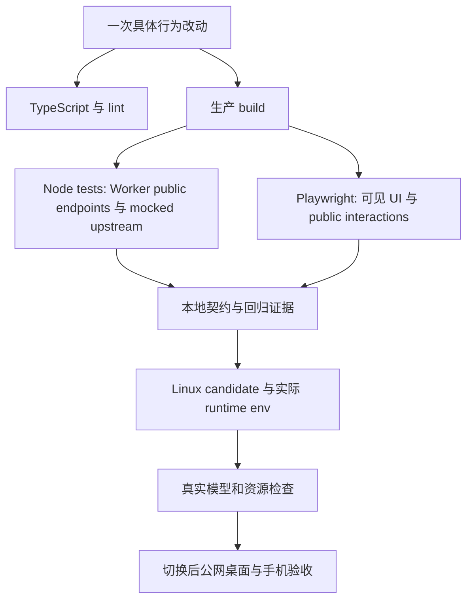
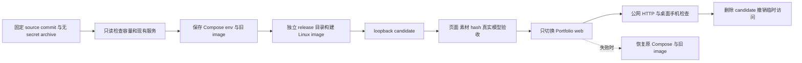

# 4 · 开发、测试、部署与回滚

[手册目录](README.md) · 上一章：[UI 与状态](03-ui-and-state.md) · 下一章：[学习与改进](05-learning-and-roadmap.md)

## 4.1 先认清运行目标

| 场景 | 怎么启动 | key 从哪里来 |
| --- | --- | --- |
| 本地开发 | `npm run dev` | Cloudflare local bindings；通常是 ignored `.dev.vars` |
| 本地 UI preview | dev server 的 `/preview/*` | sample data，无需 key |
| API 回归 | build 后 `npm run test:api` | tests mock upstream，并设置/恢复测试环境值 |
| 浏览器回归 | build 后 `npm run test:ui` | 生产 server + Playwright route mocks，无需真实模型 |
| Node 生产 | Node-target build 后 `vinext start` | 进程/container runtime environment |
| Sites / Worker | 由相应平台单独打包部署 | 那个平台的 bindings/secrets，不等于 Node env file |

不要为了修复一个目标的配置，覆盖另一个目标的凭据。

## 4.2 可复现的本地起步

```bash
node --version
npm ci
npm run dev
```

Node 至少 22.13，依赖以 lockfile 为准。访问终端打印的地址。需要固定端口时：

```bash
npm run dev -- --hostname 127.0.0.1 --port 3122
```

真实模型开发时，在 checkout 中手动创建 `.dev.vars`：

```dotenv
OPENAI_API_KEY=replace_with_your_own_runtime_key
```

不要粘贴真实 key 进入 issue、截图、README 或 shell history。已有 `.dev.vars` 时，本地 Worker bindings 不会因为另一个 shell 的 env 改动自动更新；修改后重启 server。没有 key 时，`/api/chat` 的 503 是明确的配置缺失，不是证明模型不可用。

无 key 的 UI 入口：

| 路径 | 用途 |
| --- | --- |
| `/preview/chat` | 五类真实 Card、输入框、suggestion dock、相册和视频，sample copy |
| `/preview/fun-facts` | 聚焦 Fun Facts 的照片与兴趣入口 |
| `/preview/followups` | 聚焦 bubble/dock 展开与折叠 |

这些页面在 production 必须返回 404；普通 `/chat` 使用真实 Agent。

## 4.3 测试分层



| 命令 | 证明什么 | 不证明什么 |
| --- | --- | --- |
| `npm run build` | 当前源码能产出生产构建 | 真实供应商可访问 |
| `npm run test:api` | public Worker handler 的输入、输出、错误、tool workflow 等契约 | 公网 Nginx、Linux runtime 或真实模型质量 |
| `npm run test:ui` | 当前 build 的缓存、retry、卡片、媒体和布局行为 | 真实供应商答案一定正确 |
| `tsc --noEmit` | TypeScript 静态检查 | payload 在网络上一定有效 |
| `npm run lint` | 项目配置的静态规则 | 业务完整性或漏洞审计 |
| `scripts/evaluate-*.mjs` | 对配置中的真实模型发请求并记录答案 | 完整 release gate；脚本中有历史断言，执行前需复核 |

完整本地回归：

```bash
npx playwright install chromium
npm test
node node_modules/typescript/bin/tsc --noEmit --incremental false
npm run lint
```

已有 Chrome 时：

```bash
PLAYWRIGHT_CHANNEL=chrome npm test
```

Playwright 使用 3103 端口、单 worker、失败保留 trace。API tests 直接调用 build 导出的 Worker handler，并 mock `fetch`；浏览器 tests 则把实际 UI 请求路由到可控响应。两种测试测试不同边界。

针对小改动先运行能捕获症状的最小检查；通过后再做对应回归。发布时跑完整 gate。不要在 lint 扫描目录的同时让 Playwright 清理同一测试输出目录。

## 4.4 按症状排查

| 症状 | 先查哪里 | 最小证据 |
| --- | --- | --- |
| 主回答 HTTP 400 | `parseChatMessages` / `parseChatReference` | 实际 request payload；消息是否从 user 开始交替、最后为 user、字段/长度是否有效 |
| 追问 HTTP 400 | `parseFollowupRequest` | context 是否支持；recent messages 从 user 开始交替；exclude 是否符合边界 |
| HTTP 503 | 正在运行目标的 key bindings | 只确认 key 是否存在，不打印值；改后重启 |
| HTTP 502 | upstream 分类日志 | status、kind、requestId 等；区分 authentication/rate_limit/timeout/network |
| 追问消失但主回答正常 | `useFollowupQuestions`、overlay/context/turn limit | 是否被取消、是否已经 Contact/15 turns、是否有新 context；不要让可选追问阻塞输入 |
| 刷新后少一条问题 | `chat-session.ts` 的 completed-pair 规则 | pending question 应成为 draft，不是孤立 history turn |
| preset 重复调用模型 | preset 标记、恢复 schema、Fun Facts revision | 数 `/api/chat` 请求，而不是只看动画是否出现 |
| 相册像洗牌 | signed offsets 和卡片的边缘位置 | 点击 Next/Previous 后按 x 坐标读取照片顺序；检查 incoming/outgoing 轨迹 |
| 弹层被输入框遮挡 | native dialog / portal 与 top layer | 实际 DOM、焦点、scroll/draft 恢复 |
| 本地新、线上旧 | source revision、image、Compose context | GitHub Tag 不能证明服务器已更新；检查部署日志与资源 hash |

错误调查从一个可重复症状开始。先读 source 和失败信息，再改最小路径，最后用同一检查证明修复，不要仅把 timeout 放大或把 assertion 去掉。

## 4.5 常见修改的入口

| 想改什么 | 先读 / 改哪里 | 对应验证 |
| --- | --- | --- |
| 公开简历事实 | [resume-profile.ts](../../lib/portfolio/resume-profile.ts) 及其领域 imports | API tool output 与 Profile/Skills 等卡片 |
| 联系方式 | [contact-profile.ts](../../lib/portfolio/contact-profile.ts) | exact clipboard value、失败 fallback、Agent 不接受替换 |
| 技能分组 | [skills-profile.ts](../../lib/portfolio/skills-profile.ts) | broad Skills 卡片与 focused text 路径 |
| 项目说明 | [projects.ts](../../lib/portfolio/projects.ts)、case-study pages | 链接、project selection、相关追问 |
| 题库 | snapshot + [interview-bank.ts](../../lib/agent/interview-bank.ts) | project scope、reference conflict、排除与去重 |
| 相册 | [photo-collection.ts](../../lib/portfolio/photo-collection.ts)、[dialog](../../app/chat/FunFactPhotoDialog.tsx) | 单 cover、顺序、边界、full frame、键盘和失败图 |
| 动效 | bubble/sphere/dock 与 CSS | hover/focus/blur、reduced motion、隐藏页面 cleanup |
| API / model | [resume-agent.ts](../../lib/agent/resume-agent.ts) 和 routes | schema、call count、timeout/error、真实答案复核 |
| 会话 schema | [chat-session.ts](../../lib/portfolio/chat-session.ts) | 旧记录、损坏记录、完整 pairs 和 draft 恢复 |

不要随意 bump `FUN_FACTS_REVISION`：只有旧简介不再代表批准事实时才需要失效缓存；相册布局和纯视觉改动不需要重生成 AI 简介。

## 4.6 Node build 与部署

```bash
PORTFOLIO_DEPLOY_TARGET=node npm run build
npm run start -- --hostname 127.0.0.1 --port 3000
```

这是 Node target 的本地验证，不是自动化 VPS 部署命令。仓库没有一份通用、已验证适用于任意服务器的 Docker/Compose 模板；实际生产 build files 和私有 env 留在服务器管理。不要把旧服务器路径不加核对地当成新环境配置。

当前生产流程是：



执行时必须重新确认实际 OS、memory、disk、route/resolver、端口、image、health 和 Nginx。保留 JChatMind stack/volumes；只部署 Portfolio 不应重启整个主机。

候选验收包括：新页面能打开、所有新媒体存在且 hash 匹配、production preview 返回 404、真实 `/api/chat` 和 `/api/followups` 正常。切换后再通过公网检验；candidate 本地成功不能替代 Nginx/HTTPS 和手机实际交互。

`2026-10-29` 部署保留了旧 image tag、原 Compose/env 及独立 rollback script。具体恢复位置见[当次部署记录](../deployment-2026-10-29.md)，使用前先刷新当前状态。回滚文档和脚本的存在不意味着曾对生产实际执行回滚。

## 4.7 发布不等于部署

| 对象 | 标识 | 改变了什么 |
| --- | --- | --- |
| package version | `0.9.1` | 源码包的 milestone 元信息 |
| Git commit/tree | 完整 hash | 可比较的代码/文档内容 |
| GitHub Tag/Release | `v0.9.1`，Pre-release | 可下载、可引用的源码发布和说明 |
| Production image | image digest + source revision | 当前真正对访客提供服务的 build |

v0.9.0 是正式 Demo 前的源码预览版，包含介绍、手册和已完成照片功能；v0.9.1 追加 Me 个人介绍与 Skills 视觉精简。这些源码发布不默认重部署生产服务器。最后验证过的生产 source 是 `018a0d3`，日期为 2026-10-29。

发布前：核对 remote main、审阅 diff、保留其他人的改动、验证准确 tree、更新 version/lockfile/changelog，再通过 PR、Tag 和 Release 发布。禁止用强推覆盖不相干的 remote history。

## 4.8 维护笔记

- [CONTEXT.md](../../CONTEXT.md) 放稳定词汇与当前行为，避免把它写成又一份完整手册。
- [CHANGELOG.md](../../CHANGELOG.md) 记录用户可见变化与验证范围。
- 只有难逆转、离开背景就难理解且有真实取舍的决定才值得新增 ADR；普通 UI 参数调整通常不需要。
- “所有测试通过”只覆盖那次 source 和环境。每个后续改动都应更新自己的证据。

延伸阅读：[Docker Compose 官方应用模型](https://docs.docker.com/compose/intro/compose-application-model/)；[GitHub Mermaid 渲染说明](https://docs.github.com/en/get-started/writing-on-github/working-with-advanced-formatting/creating-diagrams)。外部文档用于理解工具，不替代本项目 source 和部署记录。
