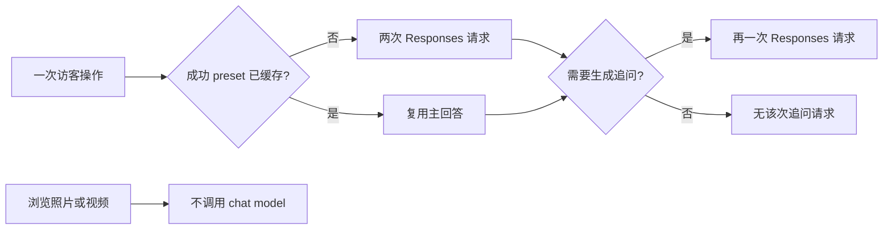

# 5 · 学习顺序与改进路线

[手册目录](README.md) · 上一章：[开发与运维](04-development-and-operations.md)

这一章把“读懂当前项目”和“设计下一版”分开。表格中的改进都还不是已经交付的能力；先理解现有边界，再选择一个可验证的小切片。

## 5.1 按消息路径读源码

| 顺序 | 阅读内容 | 读完应能回答 |
| --- | --- | --- |
| 1 | [首页](../../app/page.tsx)、[quick questions](../../lib/portfolio/quick-questions.ts)、[chat page](../../app/chat/page.tsx) | 点击 preset 与手输问题怎样到达同一个 ChatClient？ |
| 2 | [ChatClient](../../app/chat/ChatClient.tsx) 的 `sendMessage` | cache hit、in-flight、error 和 success 分别改变什么？ |
| 3 | [chat route](../../app/api/chat/route.ts) | 浏览器能发送什么，哪些内容由服务端补充？ |
| 4 | [resume-agent](../../lib/agent/resume-agent.ts) | 为什么是两次 Responses 调用？哪里执行 tool？ |
| 5 | [resume profile](../../lib/portfolio/resume-profile.ts) 与领域模块 | 事实的唯一来源在哪里？UI 与 Agent 哪些内容共享？ |
| 6 | [interview context](../../lib/portfolio/interview-context.ts)、[bank selection](../../lib/agent/interview-bank.ts) | 点击 reference 和手输关键词各走哪条选择路径？ |
| 7 | [followup hook](../../app/chat/useFollowupQuestions.ts)、[followup contract](../../lib/portfolio/followup-questions.ts) | 为什么主回答成功仍可能没有追问？旧结果如何被排除？ |
| 8 | [session](../../lib/portfolio/chat-session.ts) 与卡片 | 为什么只保存完整 pairs？为何恢复时重建 Card？ |
| 9 | [媒体 dialog](../../app/chat/FunFactPhotoDialog.tsx)、[sphere](../../app/chat/thinking-sphere.ts) | 如何控制资源、focus、motion 和 cleanup？ |
| 10 | [tests](../../tests)、[生产记录](../deployment-2026-10-29.md) | mock、真实模型、生产浏览器分别提供什么证据？ |

建议边读边在 DevTools 的 Network 中观察 `/api/chat` 与 `/api/followups`，并查看当前 tab 的 `portfolio.chat.v1`。不要只凭视觉变化推断网络是否发生。

## 5.2 五个能验证理解的实验

在新 branch 上一次只做一个实验，开始前记下预期，结束后保留一条 public-interface 验证路径。

### 实验 A：理解缓存的成本边界

1. 第一次点击 Skills，记录 `/api/chat` 和 `/api/followups` 请求。
2. 再点 Skills，确认主回答复用，追问仍可能生成。
3. 刷新，再点 Skills，确认 completed preset 恢复逻辑。
4. 比较“前端缓存回答”和“供应商请求成本”为什么不是同一件事。

验收：只统计主回答时应看到 cache reuse；不要把 suggestion 请求误报为 cache 失效。

### 实验 B：理解输入校验与 retry

通过测试路由返回一次 502，再恢复 200，观察 pending message 被移除、文本回到 draft，以及 retry 没有重复 user turn。接着给 API 发不交替的 messages，观察 400；两种失败的责任边界不同。

验收：Thinking 停止、draft 可编辑、成功后 history 成对。参考 [retry specs](../../tests/browser/chat-retry.spec.ts)。

### 实验 C：理解 context 与 reference

先在 Projects carousel 选择 JChatMind，再在手输问题中明确点名 Lyntra；检查最终 request 与题库选择。再故意组合不一致的 questionId/project，观察契约拒绝与合法路径。

验收：能够解释显式问题、浏览器 hint 和 reference 的关系，而不是用“模型自己记住了项目”来解释。

### 实验 D：理解单方向动画

打开相册并定位第 15 张，记录五张可见 Card 的 x 坐标与编号。Next 后它们应按顺序整体向左移；Previous 反向。缩小到手机宽度，再启用 reduced motion。

验收：次序和可操作性不依赖动画；隐藏的边缘 Card 不穿过中央。参考 [photo specs](../../tests/browser/fun-facts-photo.spec.ts)。

### 实验 E：理解“事实更新”和“UI 更新”

仅改相册边距时，不改 `FUN_FACTS_REVISION`；再模拟批准事实变化，检查旧 summary 仍可读、preset 下一次只重生成一次。讨论哪些数据应通过 shared module 改，哪些只属于 UI。

验收：不会因为纯视觉调整让所有访客额外调用模型，也不会让过时事实一直命中成功缓存。

## 5.3 正式 Demo 前优先处理什么

当前不是缺少一个复杂功能，而是需要把已有体验的边界进一步收紧。

| 优先级 | 现状 / 问题 | 最小改进切片 | 可观察的验收 |
| --- | --- | --- | --- |
| P0 | 15-turn 是对请求/客户端会话的限制，没有 durable visitor quota | 在实际入口设计一层服务端 rate/cost control，先确定访客标识、窗口和失败策略 | 新 chat / 直接 POST 不能绕过选定限额；合理用户有可恢复反馈 |
| P0 | 浏览器 abort 没有串联到 Agent upstream controller | route → Agent → fetch 显式传递 cancellation，并定义 Node/Worker 支持边界 | 页面取消后服务端模拟 upstream 观察到 abort；非取消请求仍成功 |
| P0 | UI 等待和 upstream timeout 分开，main request 没有与追问一样完整的卸载/序号保护 | 给主回答补一个独立的生命周期保护切片 | 路由切换和过期响应不会写回旧会话；retry 不丢草稿 |
| P0 | 900/300-character 是 prompt 指导，chat parser 只做较少后置约束 | 明确超长和 malformed 回答的处理契约；选一个输出边界实施 | 不把无法恢复的长文本写入 session；合法回答不被误截断 |
| P1 | 缺少持久的 latency/call-count/错误观测 | 先加入不记录敏感正文的 request correlation 和阶段耗时 | 能区分 first tool call、final answer、followups，而不输出 key/profile 全文 |
| P1 | 真实模型评价脚本有历史期待 | 维护小型、版本化的 evaluation cases 与人工判读标准 | covers broad/focused intent、语言、未知事实、题库冲突和主动追问边界 |
| P1 | reload 保留 pending text，但 pending reference 仅存在内存 | 决定是否需要安全地持久化 reference，并设计兼容 schema | reload retry 不误用旧 questionId；旧记录可恢复 |
| P1 | 多条 Projects 卡片共用 active 状态范围较宽 | 以具体 message/card identity 约束当前 carousel callback | 非当前卡片的滚动不刷新当前项目的追问 |
| P1 | overlay close 不自动重启已经取消的追问生成 | 明确产品期望后单独实现恢复策略 | 关闭媒体后恰好生成需要的一次追问，快速开关不产生重复请求 |
| P2 | 资料必须改代码发布 | 内容规模确有需要时再比较轻量 CMS / snapshot pipeline | 数据有 schema、review 和版本；不把任意后台输入当作可信 prompt |
| P2 | Footprints / 部分项目目的地未完成 | 先整理一份可核验的内容与体验目的 | 每个开放链接都有真实内容，无虚假指标或伪装可点击项 |

这些是源码审阅能支持的改进方向，不等于已做完整安全审计，也不是证明线上已经受到滥用。先定义要保证的行为，再选技术。

## 5.4 什么暂时不必增加

- 只有 40 条可维护问答时，不必为了展示技术名词立即引入 embeddings/vector DB；先量化当前 lexical selection 在哪些输入上失败。
- 没有跨设备需求时，不必先加登录、完整用户系统和会话数据库；它们会引入数据生命周期、权限与运维责任。
- 不要把相册、视频或复制操作都交给模型。当前确定性 UI 本来就能完成它们。
- 不要把 JChatMind 的 RAG/SSE 能力写成 Portfolio 自己实现的能力。可以展示两个系统的联系，也要保留边界。
- 不要在缺少恢复和观测时，先把固定 tool workflow 改成无限循环的 autonomous Agent。

## 5.5 成本和性能怎样讨论

请求数只是一部分，实际费用还取决于模型、输入/输出 token、取消是否真正抵达 upstream 等。不要把“缓存命中”写成“零成本”，也不要在没有当前计费证据时给出每访客的固定金额。

性能讨论同样要区分：本地 build 时长、模型响应时长、页面交互、图片下载、手机 GPU 负载。WebGL 首页与 hover sprite 是不同路径；把动画做得轻，不会自动减少 Agent 的两次网络等待。

## 5.6 正式 Demo 的完成标准

- 五个主入口和 typed follow-up 的体验连贯，失败可以恢复。
- 真实模型能正确区分 broad card 与 focused text，承认未知个人事实。
- 相册和视频在手机/键盘/reduced motion 下都可使用。
- 页面明确区分录制证据、sample preview 与独立 live demo。
- API/浏览器 regression、真实模型检查与公网验收各有当前证据。
- 发布内容、生产 revision、回滚路径和临时权限清理可以追溯。
- README、手册和代码没有互相矛盾的能力描述。

v0.9 是这个标准前的可用预览版。剩余工作应按实际问题和验收结果推进，不必为了“正式版”继续堆功能。

## 5.7 复盘时可以这样解释

先说访客要做什么，再说关键机制和取舍：

> 这个 Portfolio 用对话帮助访客探索项目与背景。Agent 先通过只读 tool 获取批准事实，再返回结构化的表达选择；React 渲染真实卡片。会话连续性主要由 tab-local storage 和成功 preset cache 提供，追问则是独立的、项目相关的请求。这样能让确定性界面和模型表达分工清晰，代价是一次新回答需要两次供应商请求，且还要继续完善取消、配额和观测。

这段是技术表达模板，描述实现而非个人贡献证明。介绍自己的工作时，按真实参与和 AI 辅助过程调整，不能把团队工作、设想或别的项目能力据为当前已交付成果。

## 5.8 延伸阅读

- [React · Managing State](https://react.dev/learn/managing-state)：对照 ChatClient 和独立 followup hook，理解状态组织、派生状态与共享边界。
- [TypeScript Handbook](https://www.typescriptlang.org/docs/handbook/intro.html)：对照 union types 和 runtime parser，区分静态类型与网络数据校验。
- [Docker Compose 应用模型](https://docs.docker.com/compose/intro/compose-application-model/)：对照 Portfolio 与 JChatMind 的 service/container/volume 边界。
- [GitHub 图表说明](https://docs.github.com/en/get-started/writing-on-github/working-with-advanced-formatting/creating-diagrams)：维护手册中的 Mermaid source。

这些链接用于概念学习；仓库实际依赖版本、供应商协议和部署结果以对应代码与当次记录为准。
