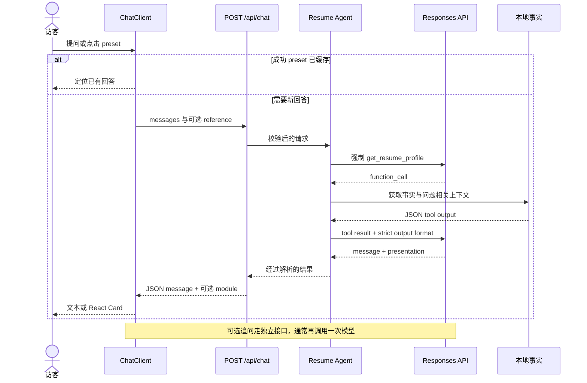

# Portfolio 学习与维护手册 · v0.9

这套手册用来回答两个问题：**现在的系统到底怎样工作？以后应该从哪里改？**

内容按当前源码核对，保留英文模块名，解释使用中文。它是一份工程导读，不是把所有文件逐行复述，也不把计划中的能力写成已经实现。阅读代码时，以仓库相应版本为准；线上状态以有日期的部署记录为准。

## 从哪里开始

| 你的目标 | 建议顺序 |
| --- | --- |
| 十分钟理解全貌 | 本页 → [整体架构](01-architecture.md) → README 中的产品截图 |
| 看懂一条消息如何变成回答 | [Agent 与数据](02-agent-and-data.md) → [UI 与状态](03-ui-and-state.md) |
| 修改事实、卡片或交互 | [UI 与状态](03-ui-and-state.md) → [开发与运维](04-development-and-operations.md) 中的改动清单 |
| 调试失败或部署问题 | [开发与运维](04-development-and-operations.md) → 对应源码与测试 |
| 为面试复盘、准备下一阶段 | [学习与改进路线](05-learning-and-roadmap.md) → 带验收路径的小实验 |

## 五章目录

1. [整体架构与模块地图](01-architecture.md)：系统边界、运行拓扑、目录职责、事实所有权和主要取舍。
2. [Agent、接口与数据链路](02-agent-and-data.md)：两次 Responses 调用、read-only tool、JSON 契约、题库筛选、错误和真实限制。
3. [UI、缓存与交互状态](03-ui-and-state.md)：preset cache、sessionStorage、retry、取消、scroll/focus、相册/视频与动效。
4. [开发、测试、部署与回滚](04-development-and-operations.md)：本地配置、两类 build target、排查顺序、发布和线上验收。
5. [学习顺序与改进路线](05-learning-and-roadmap.md)：源码阅读路线、关键问题、实验、正式 Demo 前的优先事项。

图使用 Mermaid，GitHub 可以直接渲染。源码链接可以跳到对应文件。发布附件还提供离线 HTML 手册，方便连贯阅读。

## 一条最重要的主链路

## 先分清这些概念

| 容易混淆的词 | 在本项目中的含义 |
| --- | --- |
| Agent | 服务端固定、受约束的两阶段 tool workflow；不是可任意执行任务的通用 Agent。 |
| Tool | `get_resume_profile` 读取代码拥有的事实；没有写库、发信或 shell tool。 |
| Knowledge / 题库 | 随源码发布的本地 JSON snapshot 和 lexical selection；不是向量数据库。 |
| Card | React 确定性组件；模型只返回 presentation，不生成卡片 HTML。 |
| Cache | 当前 tab 内的成功 preset 回答复用；追问生成仍可能调用模型。 |
| Streaming | 此 Portfolio 返回完整 JSON 后再做淡入；JChatMind 的 SSE 讨论属于另一个系统。 |
| Preview | `/preview/*` 是 sample-data 设计页面，仅开发环境存在。 |
| Release / Deploy | GitHub 的源码 Tag/Release 与生产服务器切换是两件事。 |

## 当前基线与证据

- v0.9.0 是正式 Demo 前的 Pre-release，主要补齐介绍、学习资料与已完成相册的源码发布。
- 2026-10-29 的[生产验收](../deployment-2026-10-29.md)对应源码 `018a0d3`，包括公网桌面/手机、真实 AI 请求和媒体校验。
- v0.9 的检查结果记录在[发布说明](../releases/v0.9.0.md)。历史通过的测试不替代下一次改动后的复验。
- 当前仓库没有跨设备会话、Portfolio 数据库、Portfolio 向量 RAG、后台 autonomous jobs 或持久化访客配额；相关内容只能列为后续设计。

## 文档怎样保持准确

每次修改一个行为，沿着“输入 → 状态 → 接口 → 数据 → 输出”检查对应章节，再更新测试与说明。例如换模型会影响 Agent 文档和真实模型验收；换相册排列只影响媒体交互与 UI 章节，不需要把照片内容写入简历事实。

不要把真实 `.dev.vars`、`.env*`、生产私钥、原始访谈准备材料或服务端 `agentReference` 的个人值复制进手册。本文只解释这些边界和数据类别。

返回[项目首页](../../README.md) · 查看[项目词汇](../../CONTEXT.md)
